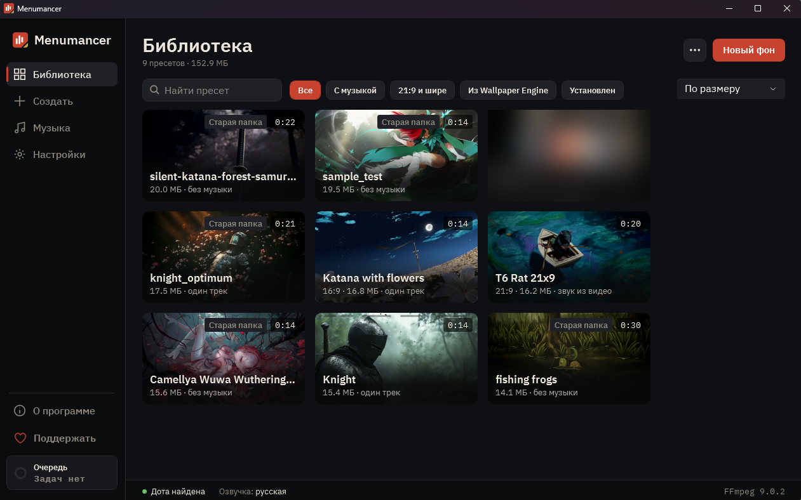
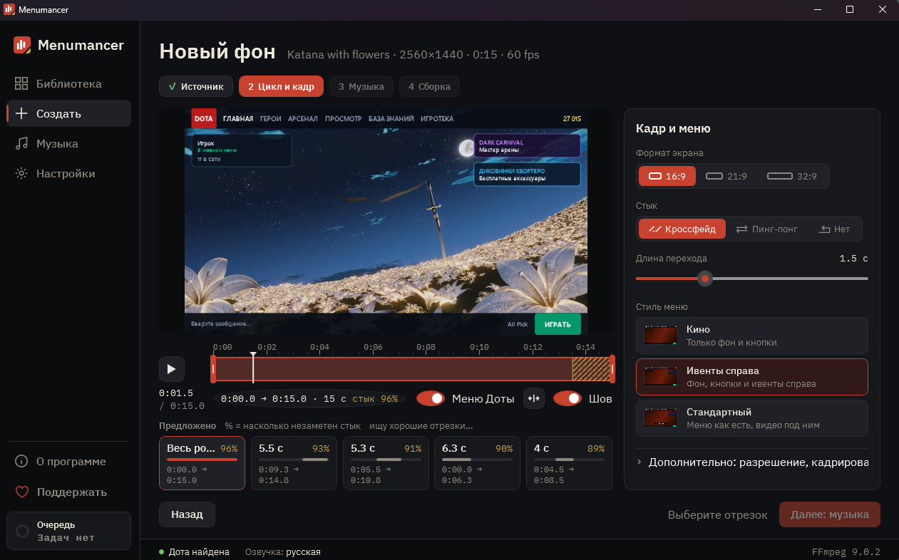

<h1 align="center">Menumancer</h1>

Свой живой видеофон и музыка в главном меню Dota 2. 
<a href="https://github.com/Laraden/menumancer/releases/latest"><b>Скачать последнюю версию</b></a> · <a href="#english">English</a>

> Неофициальная фанатская программа. Не связана с Valve Corporation и не одобрена ею.

## Что делает

- Берёт любое видео (MP4, WebM, MKV, MOV) или видео-обои из Wallpaper Engine и делает из него фон главного меню.
- Сама находит отрезок, который красиво зацикливается, и показывает макет меню Доты поверх видео, чтобы было видно, что закроют кнопки.
- Ставит вашу музыку в меню, на заставку, выбор героя, победу и поражение: один трек, случайный трек или микс из плейлиста.
- Подходит для широких мониторов: 16:9, 21:9 и 32:9.
- Ставит фон в игру одной кнопкой и так же одной кнопкой убирает.
- Делится фоном с друзьями пресетом: в нём настройки без видео, а видео друг берёт из источника сам (подписывается на те же обои в Workshop или скачивает по ссылке), и Menumancer собирает у него тот же фон. Своё видео или видео под свободной лицензией можно отправить и ZIP-архивом.

## Как начать

1. Скачайте `Menumancer-<версия>-win-x64.exe` со страницы [Releases](https://github.com/Laraden/menumancer/releases/latest). Устанавливать не нужно, это один файл.
2. Запустите его. Windows может показать «Система Windows защитила ваш компьютер»: у программы пока нет платного сертификата издателя. Нажмите «Подробнее» → «Выполнить в любом случае».
3. Если FFmpeg не найден, программа предложит поставить его кнопкой (через winget). FFmpeg нужен для работы с видео.
4. «Создать» → выберите видео → выберите цикл → музыку → «Собрать». Галочка «Сразу поставить в Доту» поставит фон сразу.
5. Запустите Доту. Перед установкой и снятием фона Доту нужно закрыть.

При первом запуске программа покажет короткий тур по экранам. Гайды по каждому разделу: [docs/guide](docs/guide/ru/README.md), и в самой программе кнопкой «?» у заголовка раздела.

## Требования

- Windows 10 или 11, 64 бит.
- Dota 2 в Steam.
- FFmpeg (программа поставит его сама или найдёт уже установленный).
- Wallpaper Engine по желанию, если хотите брать видео-обои оттуда.

## Чужие видео и обои

- Видео, обои и музыка принадлежат их авторам. Menumancer не содержит и не раздаёт чужие видео: он делает фон на вашем компьютере из того, что у вас уже есть, и для себя так можно.
- Передавать другим само видео можно, только если оно ваше, под свободной лицензией или автор разрешил. В остальных случаях делитесь пресетом: друг возьмёт видео из источника сам.
- Обои из Steam Workshop всегда передаются только пресетом. Menumancer не связан с Wallpaper Engine.

## Безопасно ли это

- Программа добавляет в языковую папку игры один файл с оформлением главного меню. Файлы Valve она не перезаписывает.
- Не трогает процесс игры, не читает его память, не даёт игрового преимущества.
- Не подменяет то, что продаётся в игре: если у вас надет музыкальный пак, звучит он.
- Изменение файлов игры формально не разрешено [Соглашением подписчика Steam](https://store.steampowered.com/subscriber_agreement/) (п. 2.G). Нам неизвестны баны за такие косметические изменения, но гарантировать этого никто не может. **Вы пользуетесь программой на свой риск.**
- После обновления Доты фон иногда перестаёт работать. Если игра пишет «Locally modified game files detected» или не пускает в поиск, нажмите «Снять» на карточке фона или «Убрать мод из Доты» в Настройках. Если не помогло: Steam → Dota 2 → Свойства → Установленные файлы → «Проверить целостность файлов игры».

## Обновления

Программа сама проверяет новые версии раз в сутки (можно выключить в «О программе») и ставит их только по вашей кнопке «Обновить». Каждое обновление подписано: программа проверяет подпись и контрольную сумму, прежде чем что-то заменить.

## Где лежат файлы

- Ваши фоны: `Документы\Menumancer`.
- Настройки: `%APPDATA%\Menumancer`.
- Журналы и временные файлы: `%LOCALAPPDATA%\Menumancer`.

Чтобы удалить программу полностью: «Убрать мод из Доты» в Настройках, потом удалите exe и эти три папки.

**Портативный режим.** Создайте рядом с exe пустую папку `Menumancer-data`: программа будет хранить в ней всё (настройки, фоны, журналы) и ничего не писать в Документы и AppData. Так её можно носить на флешке вместе с фонами.

## Нашли ошибку

Откройте [issue](https://github.com/Laraden/menumancer/issues/new/choose) и опишите, что делали и что случилось. Очень помогает версия из «О программе» и журнал из `%LOCALAPPDATA%\Menumancer\logs`.

## Поддержать

Программа бесплатная. Если она вам понравилась, можно поддержать разработку на [DonationAlerts](https://www.donationalerts.com/r/dverse) (кнопка есть и в «О программе»).

---

## English

**Menumancer** puts your own animated video background and music into the Dota 2 main menu.

- Any video (MP4, WebM, MKV, MOV) or a Wallpaper Engine video wallpaper becomes a seamless menu loop, previewed under a mock of the Dota menu.
- Your own music for the menu, startup, hero pick, victory and defeat: one track, a random track or a mix from a playlist.
- 16:9, 21:9 and 32:9 screens.
- One click to install the background, one click to remove it. Share it with friends as a preset: settings without the video, your friend gets the video from its source (Workshop subscription or a link) and the app builds the same background. Your own or freely licensed videos can also go as a ZIP.
- The app is in Russian and English (Settings → App language).

**Getting started.** Download `Menumancer-<version>-win-x64.exe` from [Releases](https://github.com/Laraden/menumancer/releases/latest) and run it, no installation needed. Windows SmartScreen may warn that the app is unrecognized (it has no paid publisher certificate yet): click "More info" → "Run anyway". The app offers to install FFmpeg through winget if it is missing. Close Dota before installing or removing a background.

**Requirements.** Windows 10/11 64-bit, Dota 2 on Steam, FFmpeg. Wallpaper Engine is optional.

**Other people's videos.** Videos, wallpapers and music belong to their authors. Menumancer contains and distributes none of them: it builds a background on your PC from what you already have, which is fine for your own use. Pass the video itself on only if it is yours, under a free license or the author allowed it; otherwise share a preset. Workshop wallpapers are always shared as a preset. Menumancer is not affiliated with Wallpaper Engine.

**Is it safe?** Menumancer is an unofficial fan tool, not affiliated with or endorsed by Valve. It adds one cosmetic main-menu file to the game's language folder and never overwrites Valve files. It does not touch or read the game process, gives no gameplay advantage and never replaces content sold in game (an equipped music pack keeps playing). Modifying game files is not permitted by the [Steam Subscriber Agreement](https://store.steampowered.com/subscriber_agreement/) (section 2.G). We know of no bans for cosmetic changes like this, but nobody can guarantee it: **use at your own risk.** If a Dota update breaks the menu or blocks matchmaking ("Locally modified game files detected"), press "Remove from Dota" on the background card or "Remove mod from Dota" in Settings, and if needed use "Verify integrity of game files" in Steam.

**Updates** are checked once a day and installed only when you click "Update". Every update is signed, and the app checks the signature and checksum before replacing anything.

**Portable mode:** create an empty `Menumancer-data` folder next to the exe and the app keeps everything there (settings, backgrounds, logs) instead of Documents and AppData, so you can carry it on a USB stick.

**Bugs:** open an [issue](https://github.com/Laraden/menumancer/issues/new/choose) with the version from "About" and the log from `%LOCALAPPDATA%\Menumancer\logs`.

**Support:** the app is free. You can support development on [DonationAlerts](https://www.donationalerts.com/r/dverse).

---

Menumancer бесплатна, исходный код закрыт, условия в [LICENSE.md](LICENSE.md). Dota и Dota 2 являются товарными знаками Valve Corporation. Лицензии сторонних компонентов лежат в каждом релизе (`THIRD-PARTY-NOTICES.txt`).
