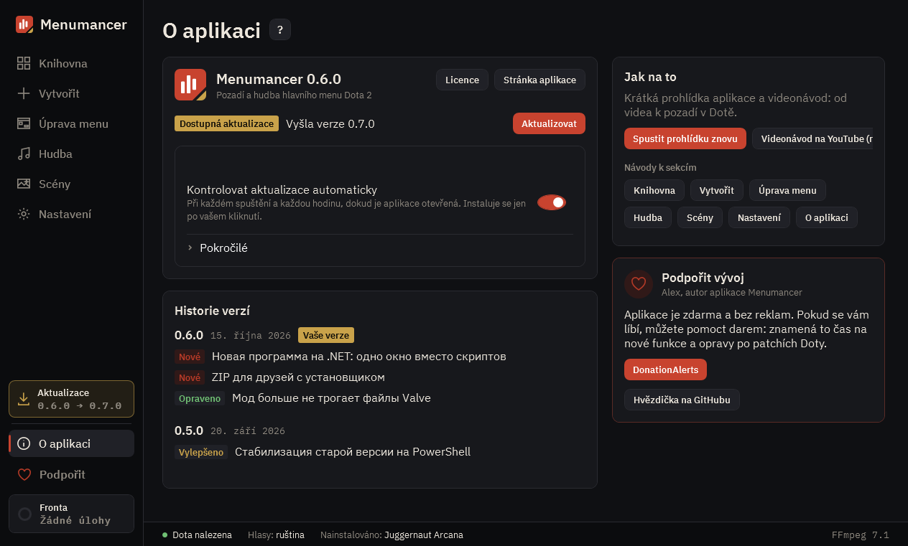

# O aplikaci

Verze, aktualizace, historie změn, všechny návody a jak podpořit vývoj.

## 1. Aktualizace

Aplikace sama hledá aktualizace při každém spuštění a každou hodinu, dokud je otevřená, a instaluje je jen po vašem kliknutí. „Testovací verze“ nabízejí to, co se ještě testuje.

## 2. Historie verzí

Co se změnilo v každé verzi. Velké aktualizace mají „Přehrát prezentaci“.

## 3. Jak používat

Prohlídka aplikace, videonávod a návod ke každé sekci. Stejný návod otevře tlačítko „?“ u nadpisu kterékoli sekce.

## 4. Podpořit vývoj

Aplikace je zdarma a bez reklam. Tady můžete podpořit autora.

---

[Všechny návody](README.md) · [Stáhnout Menumancer](https://github.com/Laraden/menumancer/releases/latest)
