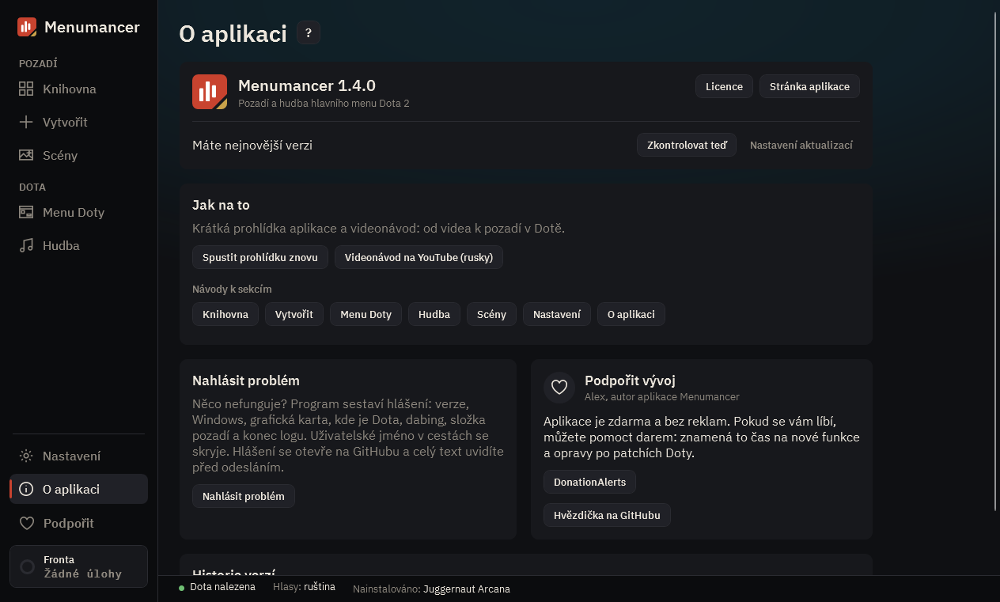

# O aplikaci

Verze, aktualizace, návody, nahlášení problému, podpora vývoje a historie změn.

## 1. Aktualizace

Verze aplikace a zda vyšla nová. „Zkontrolovat teď“ se zeptá GitHubu a aktualizace se instaluje jen po vašem kliknutí. Automatická kontrola a zkušební verze: „Nastavení aktualizací“ vede do Nastavení.

## 2. Jak používat

Prohlídka aplikace, videonávod a návod ke každé sekci. Stejný návod otevře tlačítko „?“ u nadpisu kterékoli sekce.

## 3. Podpořit vývoj

Aplikace je zdarma a bez reklam. Tady můžete podpořit autora.

## 4. Historie verzí

Co se změnilo v každé verzi. Velké aktualizace mají „Přehrát prezentaci“.

---

[Všechny návody](README.md) · [Stáhnout Menumancer](https://github.com/Laraden/menumancer/releases/latest)
