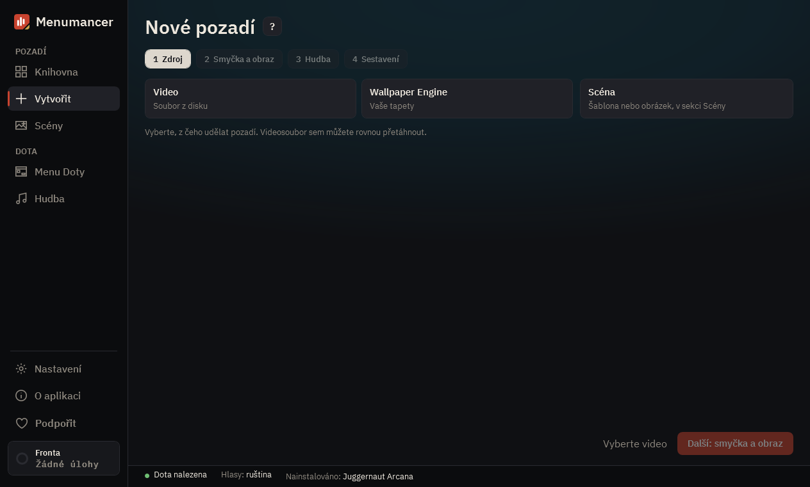

# Vytvořit

Nové pozadí ve čtyřech krocích: odkud vzít video, který úsek se bude opakovat, jaká hudba a jak ho sestavit.

## 1. Čtyři kroky

„Zdroj“, „Smyčka a obraz“, „Hudba“, „Sestavení“. K hotovému kroku se vrátíte kliknutím na něj.

## 2. Aktuální krok

Zdroj: tři dlaždice, video z disku, tapeta Wallpaper Engine nebo scéna (otevře Scény). Smyčka a obraz: úsek, který se bude přehrávat dokola, co zůstane v záběru a na kartě Vzhled hotové vzhledy a posuvníky barev. Hudba: bez hudby, zvuk z videa, jedna skladba, náhodně nebo mix.

## 3. Sestavit hned

Když je video vybrané, „Sestavit hned“ vezme nejlepší úsek, hodnoty z Nastavení a hudbu Doty a hned pozadí sestaví. Pokud plynulá smyčka není, otevře se „Smyčka a obraz“ s důvodem.

## 4. Dál a sestavení

V posledním kroku „Sestavit“ zařadí pozadí do fronty. Sestavení běží na pozadí a se zaškrtnutým „Hned nainstalovat do Doty“ se pozadí samo objeví ve hře.

---

[Všechny návody](README.md) · [Stáhnout Menumancer](https://github.com/Laraden/menumancer/releases/latest)
