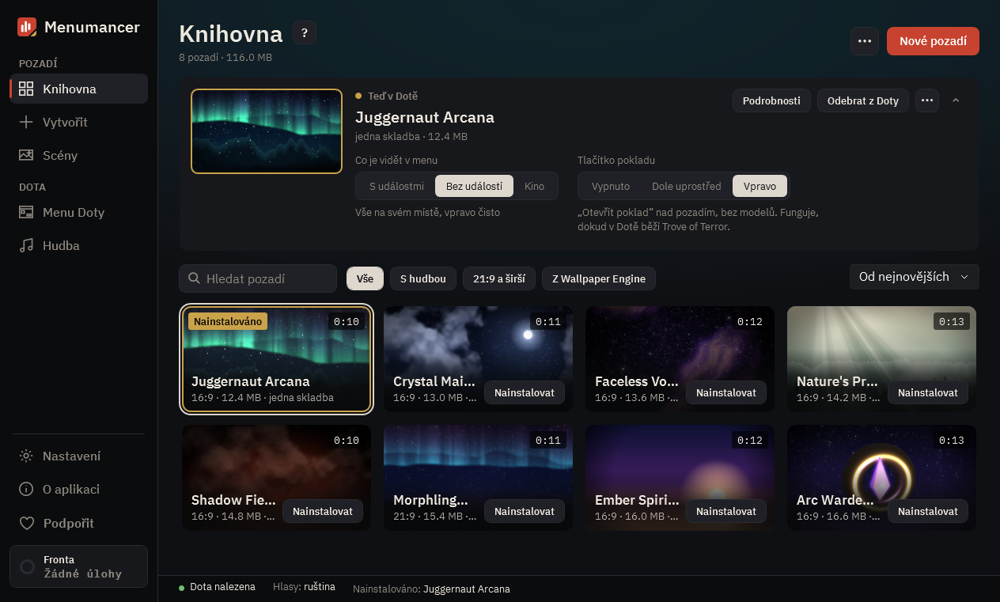

# Knihovna

Všechna vaše pozadí pro menu Doty. Tady je nainstalujete do hry, změníte jim hudbu a to, co je vidět v menu, a sdílíte je.

## 1. Nové pozadí

Tlačítko „Nové pozadí“ otevře sekci „Vytvořit“: z videa nebo tapety Wallpaper Engine vznikne pozadí ve čtyřech krocích.

## 2. Teď v Dotě

Karta nad hledáním ukazuje, co je ve hře: plakát, název, hudbu a velikost. Přepínače „Co je vidět v menu“ a „Tlačítko pokladu“ se sbírají v pruhu dole a do Doty jdou jedním „Použít“, když je hra zavřená. „Odebrat z Doty“ odebere z Doty všechny soubory Menumancer a menu bude zase původní od Valve, pozadí v knihovně zůstanou. Pod „⋯“: nainstalovat znovu, hudba, složka pozadí a spuštění Doty přes Steam. Kartu lze sbalit do řádku a program si to zapamatuje.

## 3. Hledání a filtry

Najděte pozadí podle názvu nebo nechte jen ta, která potřebujete: „S hudbou“, „21:9 a širší“, „Z Wallpaper Engine“.

## 4. Karta pozadí

„Nainstalovat“ na kartě dá pozadí do Doty, kliknutí na samotnou kartu otevře jeho nastavení. Zlatý rámeček má to, které je právě ve hře.

## 5. Nainstalovat nebo odebrat

Hlavní tlačítko „Nainstalovat“ dá pozadí do Doty, u toho, které už tam je, je to „Nainstalovat znovu“. „Odebrat z Doty“ ho odebere a menu bude zase původní od Valve. Pod „⋯“: „Sdílet pozadí“, „ZIP s videem“, „Přejmenovat“ a „Smazat pozadí…“ s potvrzením. Pokud hra běží, restartujte ji. Po aktualizaci nebo přeinstalaci Doty je potřeba pozadí nainstalovat znovu: stačí otevřít program, udělá to sám. Pokud pozadí v Dotě chybí, klikněte znovu na „Nainstalovat“, a pokud po velké aktualizaci nefunguje, počkejte na aktualizaci programu.

## 6. Co je vidět v menu

„S událostmi“ nechá menu jako v Dotě, „Bez událostí“ odstraní vpravo reklamu na události, „Kino“ nechá jen pozadí, horní lištu a spodní panely. Je tu i „Tlačítko pokladu“: dole uprostřed nebo vpravo, dokud v Dotě běží Trove of Terror.

## 7. Hudba pozadí

Hudba v menu a v dalších chvílích: vlastní skladba, playlist nebo výchozí hudba Doty. Změny uložíte tlačítkem „Použít“, video se znovu nekóduje.

## 8. Více

„Importovat ZIP“ přidá pozadí, které s vámi někdo sdílel, a „Hromadné sestavení…“ sestaví pozadí ze všech videí ve složce.

---

[Všechny návody](README.md) · [Stáhnout Menumancer](https://github.com/Laraden/menumancer/releases/latest)
