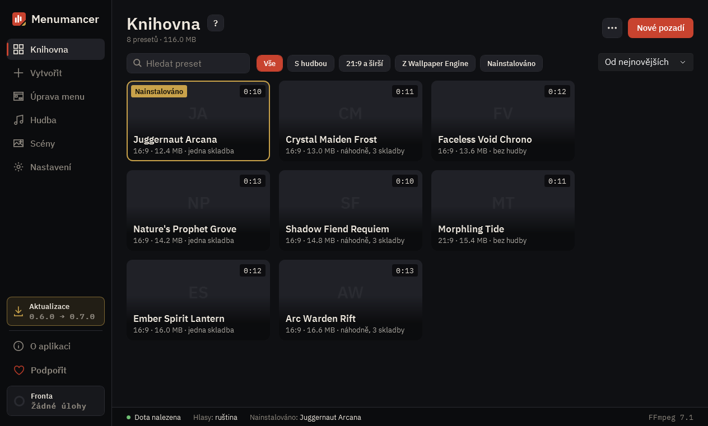

# Knihovna

Všechna vaše pozadí pro menu Doty. Tady je nainstalujete do hry, změníte jim hudbu a vzhled menu a sdílíte presety.

## 1. Nové pozadí

Tlačítko „Nové pozadí“ otevře sekci „Vytvořit“: z videa nebo tapety Wallpaper Engine vznikne pozadí ve čtyřech krocích.

## 2. Hledání a filtry

Najděte pozadí podle názvu nebo nechte jen ta, která potřebujete: „S hudbou“, „21:9 a širší“, „Z Wallpaper Engine“, „Nainstalováno“.

## 3. Karta pozadí

Najeďte na kartu: „Nainstalovat“ dá pozadí do Doty, „Podrobnosti“ otevře jeho nastavení. Zlatý rámeček má to, které je právě ve hře.

## 4. Nainstalovat nebo odebrat

„Nainstalovat“ dá pozadí do Doty, „Odebrat z Doty“ vrátí výchozí. Pokud hra běží, restartujte ji. Po aktualizaci nebo přeinstalaci Doty je potřeba pozadí nainstalovat znovu: stačí otevřít program, udělá to sám. Pokud pozadí v Dotě chybí, klikněte znovu na „Nainstalovat“, a pokud po velké aktualizaci nefunguje, počkejte na aktualizaci programu.

## 5. Co je vidět v menu

„Standardní“ nechá menu jako v Dotě, „Bez událostí“ odstraní vpravo reklamu na události. Je tu i „Tlačítko pokladu“: dole uprostřed nebo vpravo, dokud v Dotě běží Trove of Terror.

## 6. Hudba pozadí

Hudba v menu a v dalších chvílích: vlastní skladba, playlist nebo výchozí hudba Doty. Změny uložíte tlačítkem „Použít“, video se znovu nekóduje.

## 7. Více

„Importovat ZIP“ přidá pozadí, které s vámi někdo sdílel, a „Hromadné sestavení…“ sestaví pozadí ze všech videí ve složce.

---

[Všechny návody](README.md) · [Stáhnout Menumancer](https://github.com/Laraden/menumancer/releases/latest)
