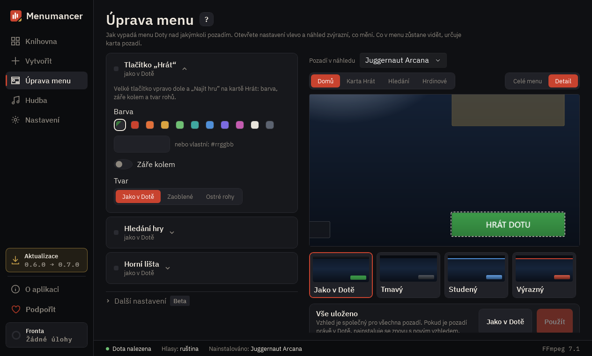

# Úprava menu

Vlastní vzhled hlavního menu Doty. Na očích je základ: barva tlačítka „Hrát“, panel hledání hry a horní lišta. Zbytek (nápisy, profil, figurky hrdinů, stránky) je v části „Další nastavení“ s označením beta: už funguje, ale ještě ho dolaďujeme. Mění se jen vzhled přes soubor modu: v zápase se nic nemění a okno přijetí hry, Dota Plus ani střepy nijak neměníme.

## 1. Nastavení

Každý blok mění jednu část menu. Otevřete blok a náhled vpravo zvýrazní a přiblíží, co mění. Zlatá značka u nadpisu znamená, že už to není jako v Dotě.

## 2. Náhled

Schéma menu s vašimi nastaveními. Přepínejte pohled: hlavní stránka, karta „Hrát“, hledání zápasu nebo Hrdinové. Kliknutím na část schématu otevřete její nastavení.

## 3. Další nastavení (beta)

Nápisy na tlačítkách, profil a přátelé, eventy, figurky hrdinů, stránky Hrdinové a Zbrojnice a úvod. Už fungují, ale ještě je dolaďujeme, takže se jejich vzhled a nabídka může změnit. Pokud tu už něco není jako v Dotě, u nadpisu svítí zlatá značka.

## 4. Hotové vzhledy

Kliknutím na vzhled převezmete všechny jeho barvy najednou. Vaše nápisy na tlačítkách zůstanou.

## 5. Použít

„Použít“ uloží nastavení a znovu sestaví nainstalované pozadí. Dota přitom musí být zavřená. „Jako v Dotě“ vrátí vše, jak bylo.

---

[All guides](README.md) · [Download Menumancer](https://github.com/Laraden/menumancer/releases/latest)
