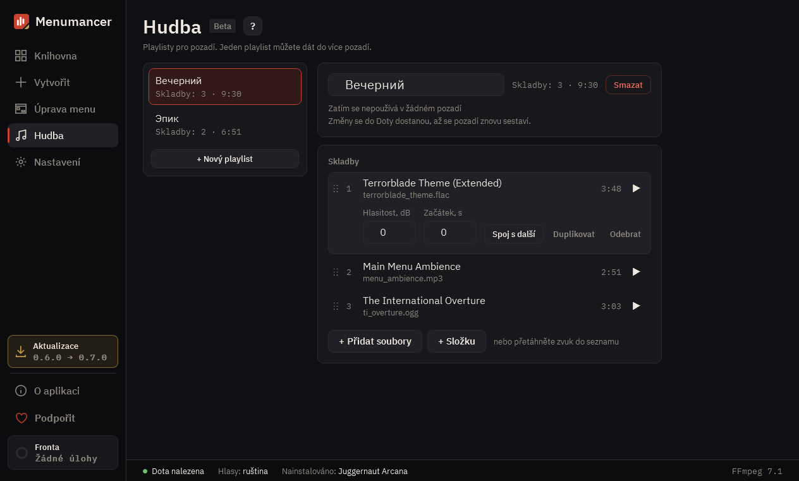

# Hudba

Playlisty pro pozadí. Jeden playlist můžete dát do více pozadí a úpravy se projeví ve všech.

## 1. První playlist

Zatím tu žádné playlisty nejsou: vytvořte první a přidejte do něj své skladby.

## 2. Playlisty

Seznam vašich playlistů. „+ Nový playlist“ vytvoří další.

## 3. Playlist

Název playlistu a ve kterých pozadích se používá. Změny se do Doty dostanou, až se pozadí znovu sestaví.

## 4. Skladby

„+ Přidat soubory“ nebo „+ Složku“, případně přetáhněte zvuk do seznamu. U každé skladby můžete změnit pořadí, hlasitost, začátek a spoj s další.

---

[All guides](README.md) · [Download Menumancer](https://github.com/Laraden/menumancer/releases/latest)
