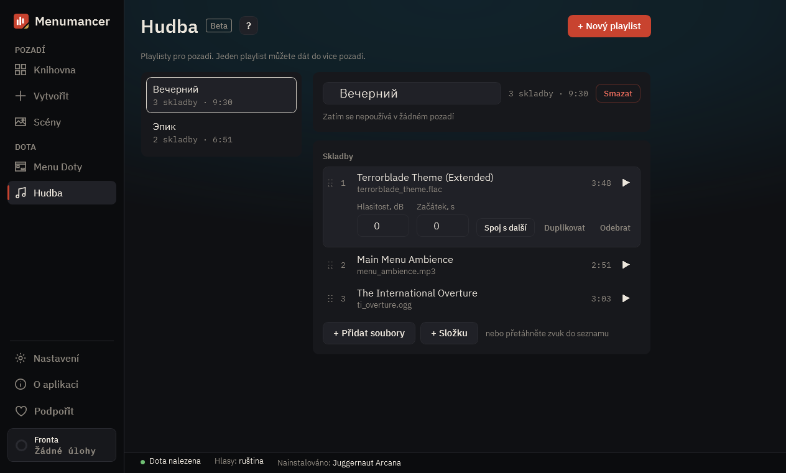

# Hudba

Playlisty pro pozadí. Jeden playlist můžete dát do více pozadí a úpravy se projeví ve všech.

## 1. První playlist

Zatím tu žádné playlisty nejsou: vytvořte první a přidejte do něj své skladby.

## 2. Playlisty

Seznam vašich playlistů. „+ Nový playlist“ nahoře na stránce vytvoří další.

## 3. Playlist

Název playlistu, kolik má skladeb a ve kterých pozadích se používá. Úpravy se do playlistu ukládají hned.

## 4. Stará verze v pozadích

Pozadí sestavená před úpravou playlistu hrají v Dotě staré skladby. „Znovu sestavit pozadí“ jim aktualizuje hudbu přes frontu úloh, video se nepřekódovává.

## 5. Skladby

„+ Přidat soubory“ nebo „+ Složku“, případně přetáhněte zvuk do seznamu. U každé skladby můžete změnit pořadí, hlasitost, začátek a spoj s další.

---

[Všechny návody](README.md) · [Stáhnout Menumancer](https://github.com/Laraden/menumancer/releases/latest)
