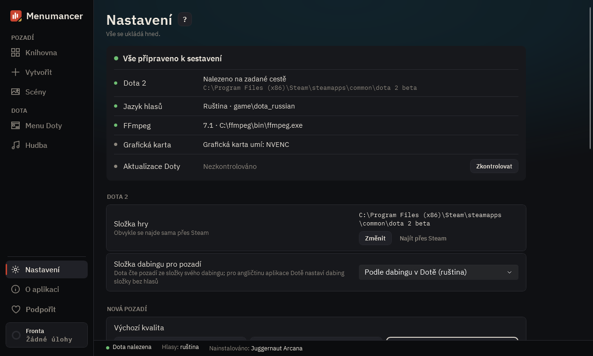

# Nastavení

Vše, co sestavení potřebuje: kde je Dota, FFmpeg, čím začíná každé nové pozadí, aktualizace a čistá Dota.

## 1. Je vše připraveno

Zda byla nalezena Dota, jaký má jazyk hlasů a zda je k dispozici FFmpeg. Pokud FFmpeg chybí, tlačítko „Nainstalovat“ ho nainstaluje přes winget.

## 2. Dota 2

Složku hry aplikace najde sama. Pokud ne, vyberte složku dota 2 beta ručně.

## 3. Nová pozadí

Tímto začíná každé nové pozadí: kvalita, rozlišení, snímková frekvence, délka prolínání na švu smyčky a co je vidět v menu. Pro jedno pozadí se to všechno dá změnit ve Vytvořit.

## 4. Aktualizace

Aplikace sama kontroluje aktualizace při každém spuštění a každou hodinu, dokud je otevřená, a instaluje je jen po vašem kliknutí. Zkušební verze a přeskočená verze jsou v „Pokročilé“.

## 5. Knihovna a aplikace

Jazyk aplikace, složka, kde jsou vaše pozadí, a záře v barvách pozadí v horní části stránek.

## 6. Čistá Dota

„Vrátit čistou Dotu“ odebere ze hry všechny soubory Menumancer: menu i hudba budou zase původní od Valve. Běží ve frontě jako sestavení a nad tlačítkem je vidět, co je teď v Dotě. Souborů Valve se aplikace nedotýká.

---

[Všechny návody](README.md) · [Stáhnout Menumancer](https://github.com/Laraden/menumancer/releases/latest)
