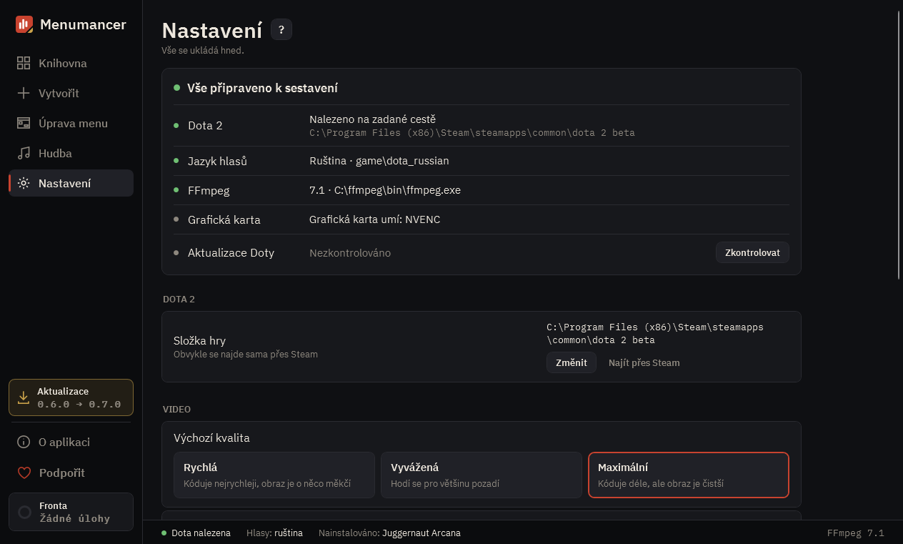

# Nastavení

Vše, co sestavení potřebuje: kde je Dota, FFmpeg, kvalita videa a co aplikace dělá.

## 1. Je vše připraveno

Zda byla nalezena Dota, jaký má jazyk hlasů a zda je k dispozici FFmpeg. Pokud FFmpeg chybí, tlačítko „Nainstalovat“ ho nainstaluje přes winget.

## 2. Dota 2

Složku hry aplikace najde sama. Pokud ne, vyberte složku dota 2 beta ručně.

## 3. Video

Rozlišení, snímková frekvence, kvalita, délka prolínání na spoji smyčky a výchozí vzhled menu. Tato nastavení platí pro nová pozadí.

## 4. Knihovna a aplikace

Jazyk aplikace a složka, kde jsou vaše pozadí.

## 5. Obnovit originál

„Odebrat mod z Doty“ vrátí hře výchozí pozadí a hudbu. Souborů Valve se aplikace nedotýká.

---

[All guides](README.md) · [Download Menumancer](https://github.com/Laraden/menumancer/releases/latest)
