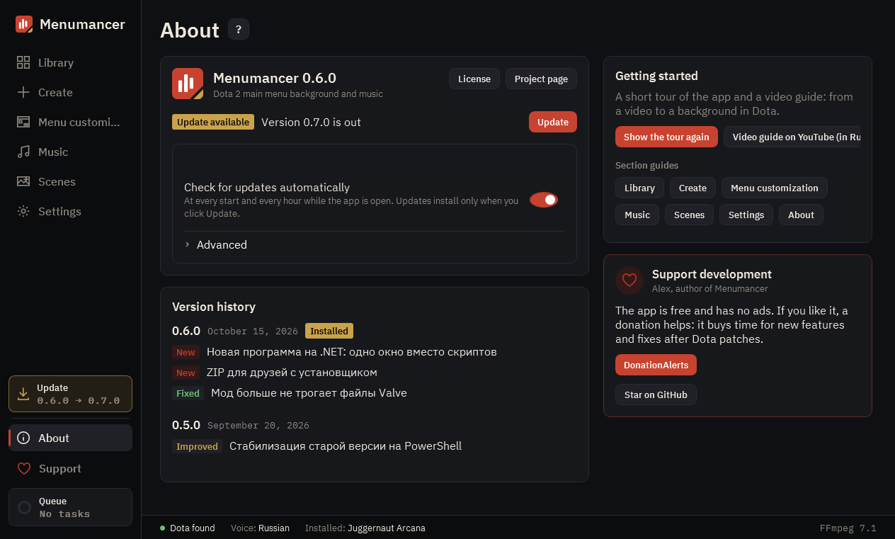

# About

Version, updates, change history, all guides and how to support development.

## 1. Updates

The app checks for updates on its own at every start and every hour while it is open, and installs them only when you click. “Pre-release versions” offers what's still being tested.

## 2. Version history

What changed in each version. Big updates have “Watch the presentation”.

## 3. How to use

A tour of the app, a video guide and a guide for every section. The same guide opens with the “?” button next to the title of any section.

## 4. Support development

The app is free and has no ads. You can support the author here.

---

[All guides](README.md) · [Download Menumancer](https://github.com/Laraden/menumancer/releases/latest)
