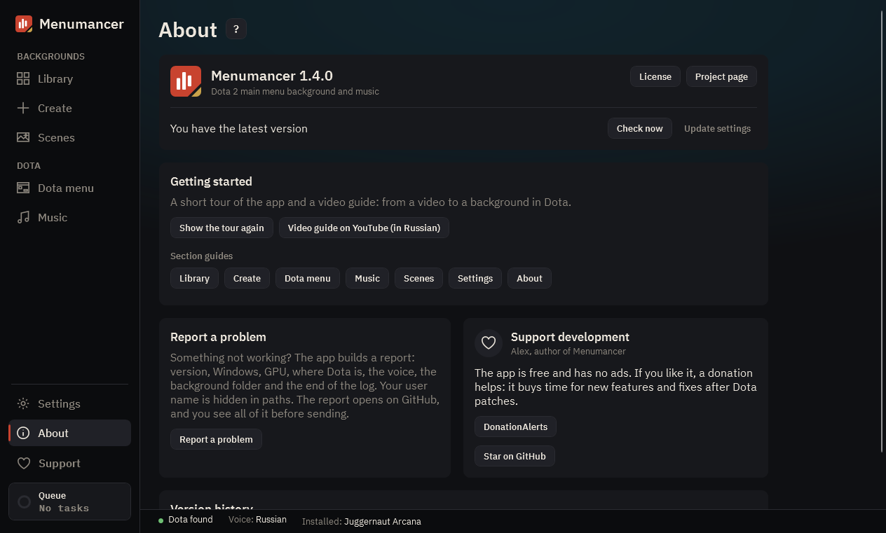

# About

Version, updates, guides, reporting a problem, supporting development and the change history.

## 1. Updates

The app version and whether a new one is out. “Check now” asks GitHub, and an update is installed only when you click. Automatic checks and pre-release versions: “Update settings” takes you to Settings.

## 2. How to use

A tour of the app, a video guide and a guide for every section. The same guide opens with the “?” button next to the title of any section.

## 3. Support development

The app is free and has no ads. You can support the author here.

## 4. Version history

What changed in each version. Big updates have “Watch the presentation”.

---

[All guides](README.md) · [Download Menumancer](https://github.com/Laraden/menumancer/releases/latest)
