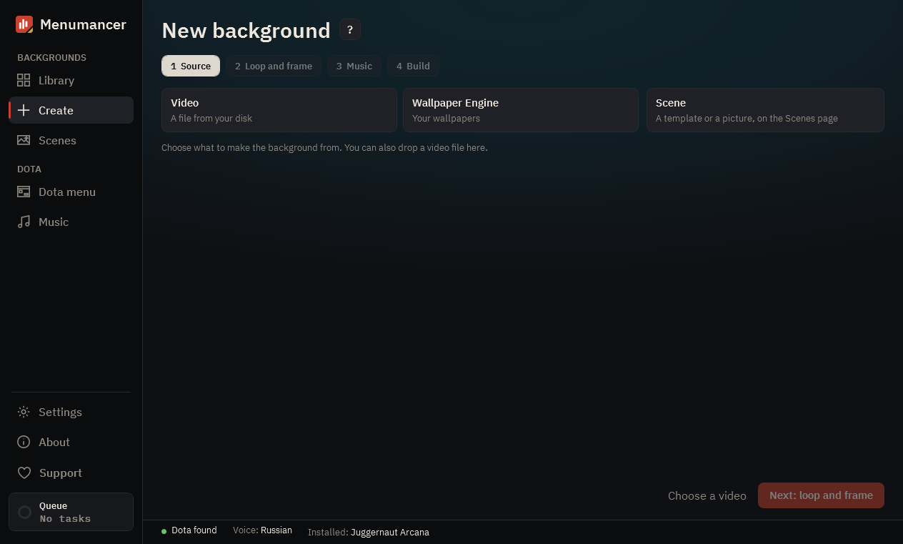

# Create

A new background in four steps: where the video comes from, which part loops, what music plays and how it's built.

## 1. Four steps

“Source”, “Loop and frame”, “Music”, “Build”. Click a step you've already done to go back to it.

## 2. Current step

Source: three tiles, a video from disk, a Wallpaper Engine wallpaper or a scene (it opens Scenes). Loop and frame: the part that plays on repeat, what stays in the frame and, on the Look tab, ready looks and colour sliders. Music: no music, the video's own sound, one track, shuffle or a mix.

## 3. Build right away

Once a video is picked, “Build right away” takes the best loop, the values from Settings and Dota's music and builds the background straight away. If there is no smooth loop, “Loop and frame” opens with the reason.

## 4. Next and build

On the last step, “Build” adds the background to the queue. Building runs in the background, and with “Install into Dota right away” ticked the background goes into the game on its own.

---

[All guides](README.md) · [Download Menumancer](https://github.com/Laraden/menumancer/releases/latest)
