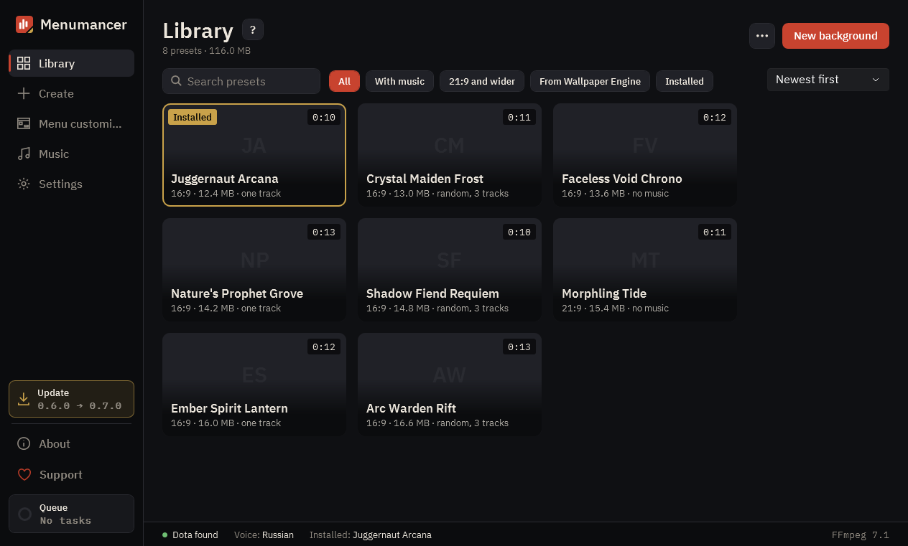

# Library

All your Dota menu backgrounds. This is where you install them into the game, change their music and menu look, and share presets.

## 1. New background

The “New background” button opens “Create”: a video or a Wallpaper Engine wallpaper becomes a background in four steps.

## 2. Search and filters

Find a background by name or keep only the ones you need: “With music”, “21:9 and wider”, “From Wallpaper Engine”, “Installed”.

## 3. Background card

Hover over a card: “Install” puts the background into Dota, “More details” opens its settings. The one in the game right now has a gold frame.

## 4. Install or remove

“Install” puts the background into Dota, “Remove from Dota” brings back the default one. If the game is running, restart it.

## 5. What the menu shows

“Standard” keeps the menu as it is in Dota, “No events” removes the event ads on the right. The “Treasure button” is here too: bottom center or on the right, while Trove of Terror runs in Dota.

## 6. Background music

Music in the menu and at other moments: your own track, a playlist or Dota's default music. “Apply” saves the changes, and the video isn't re-encoded.

## 7. More

“Import ZIP” adds a background someone shared with you, and “Batch build…” builds backgrounds from every video in a folder.

---

[All guides](README.md) · [Download Menumancer](https://github.com/Laraden/menumancer/releases/latest)
