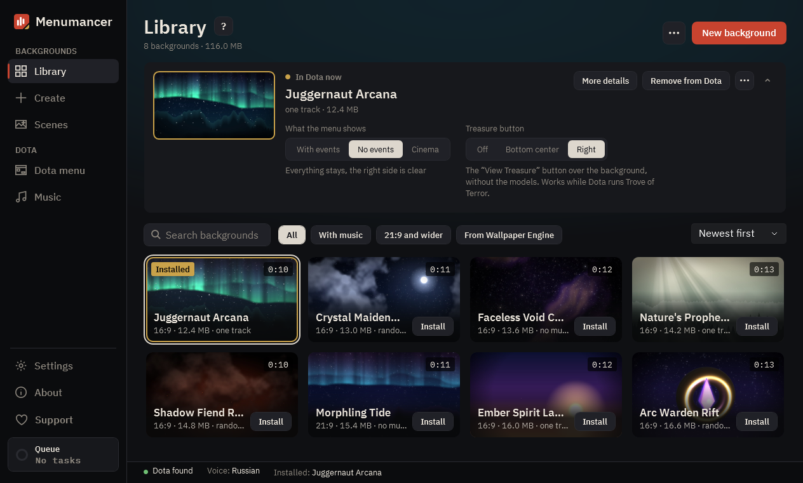

# Library

All your Dota menu backgrounds. This is where you install them into the game, change their music and what the menu shows, and share them.

## 1. New background

The “New background” button opens “Create”: a video or a Wallpaper Engine wallpaper becomes a background in four steps.

## 2. In Dota now

The card above the search shows what is in the game: the poster, the name, the music and the size. Its switches “What the menu shows” and “Treasure button” collect in the bar below and go into Dota with one “Apply” while the game is closed. “Remove from Dota” takes every Menumancer file out of Dota, and the menu is Valve's own again; your backgrounds stay in the library. Under “⋯”: reinstall, music, the background’s folder and launching Dota through Steam. Fold the card into a line and the app remembers it.

## 3. Search and filters

Find a background by name or keep only the ones you need: “With music”, “21:9 and wider”, “From Wallpaper Engine”.

## 4. Background card

“Install” on a card puts the background into Dota, a click on the card itself opens its settings. The one in the game right now has a gold frame.

## 5. Install or remove

The main button “Install” puts the background into Dota; for the one already there it is “Reinstall”. “Remove from Dota” takes it out, and the menu is Valve's own again. Under “⋯”: “Share background”, “ZIP with video”, “Rename” and “Delete background…” with a confirmation. If the game is running, restart it. After a Dota patch or reinstall, the background has to be installed again: just open the app and it does this by itself. If the background is gone from Dota, press Install again, and if it doesn’t work after a big patch, wait for an app update.

## 6. What the menu shows

“With events” keeps the menu as it is in Dota, “No events” removes the event ads on the right, “Cinema” keeps only the background, the top bar and the bottom panels. The “Treasure button” is here too: bottom center or on the right, while Trove of Terror runs in Dota.

## 7. Background music

Music in the menu and at other moments: your own track, a playlist or Dota's default music. “Apply” saves the changes, and the video isn't re-encoded.

## 8. More

“Import ZIP” adds a background someone shared with you, and “Batch build…” builds backgrounds from every video in a folder.

---

[All guides](README.md) · [Download Menumancer](https://github.com/Laraden/menumancer/releases/latest)
