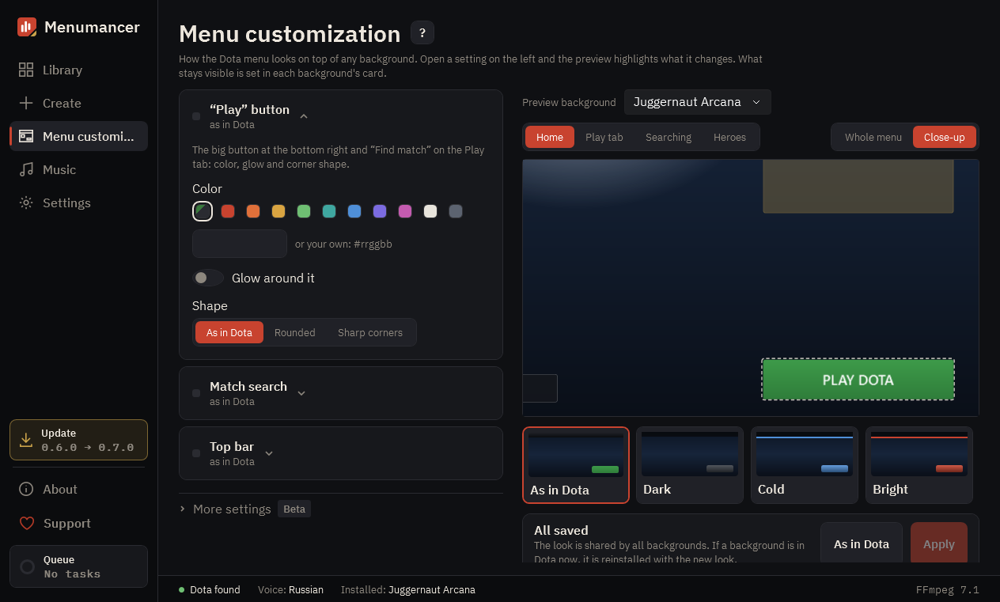

# Menu customization

Your own look for the Dota main menu. The basics are in view: the Play button color, the match search panel and the top bar. The rest (labels, profile, hero figures, pages) is under “More settings” marked beta: it already works but is still being polished. Only the look changes, through the mod file: nothing changes in a match, and the accept-match window, Dota Plus and shards are left alone.

## 1. Settings

Each block changes one part of the menu. Open a block and the preview on the right highlights and zooms in on what it changes. A gold mark next to the title means it differs from Dota.

## 2. Preview

A sketch of the menu with your settings. Switch the view: home, the Play tab, match search or Heroes. Click a part of the sketch to open its settings.

## 3. More settings (beta)

Button labels, profile and friends, events, hero figures, the Heroes and Armory pages and the intro. They already work, but we are still polishing them, so their look and options may change. If something here already differs from Dota, the header shows a gold mark.

## 4. Ready-made looks

Click a look to take all its colors at once. Your button labels stay as they are.

## 5. Apply

“Apply” saves the settings and rebuilds the installed background. Dota must be closed for this. “As in Dota” puts everything back.

---

[All guides](README.md) · [Download Menumancer](https://github.com/Laraden/menumancer/releases/latest)
