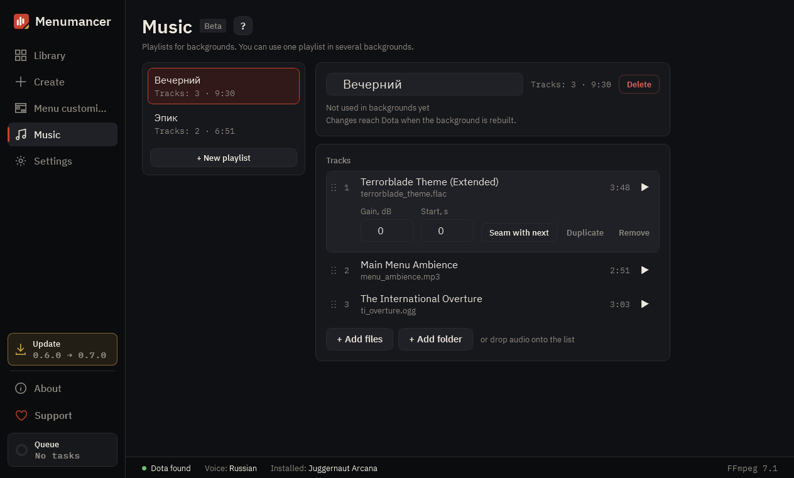

# Music

Playlists for your backgrounds. One playlist can go into several backgrounds, and your edits reach all of them.

## 1. First playlist

There are no playlists yet: create the first one and add your own tracks to it.

## 2. Playlists

Your playlists. “+ New playlist” creates another one.

## 3. Playlist

The playlist's name and which backgrounds use it. Changes reach Dota once the background is rebuilt.

## 4. Tracks

“+ Add files” or “+ Add folder”, or drag audio into the list. For each track you can change the order, volume, start and the seam with the next one.

---

[All guides](README.md) · [Download Menumancer](https://github.com/Laraden/menumancer/releases/latest)
