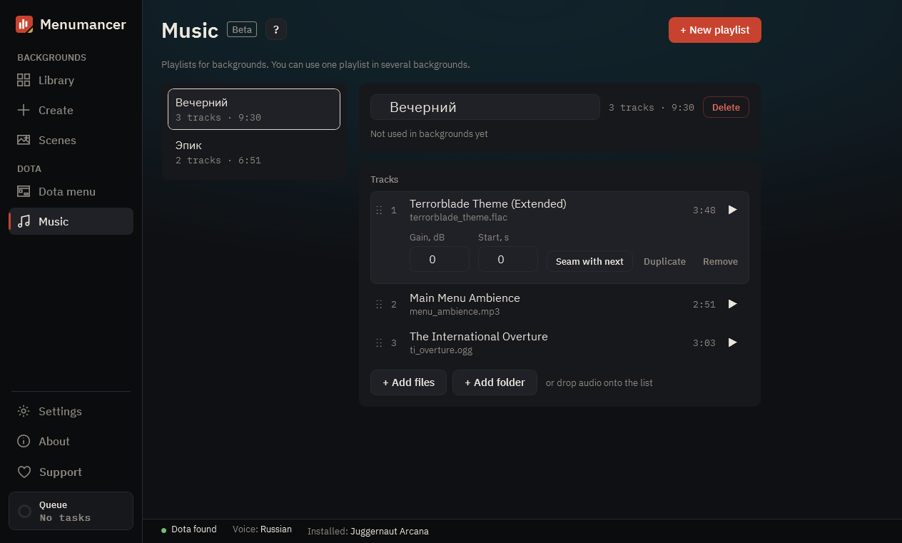

# Music

Playlists for your backgrounds. One playlist can go into several backgrounds, and your edits reach all of them.

## 1. First playlist

There are no playlists yet: create the first one and add your own tracks to it.

## 2. Playlists

Your playlists. “+ New playlist” at the top of the page creates another one.

## 3. Playlist

The playlist's name, how many tracks it has and which backgrounds use it. Edits are saved to the playlist right away.

## 4. Old version in backgrounds

Backgrounds built before you edited the playlist still play the old tracks in Dota. “Rebuild backgrounds” updates their music through the job queue, without re-encoding the video.

## 5. Tracks

“+ Add files” or “+ Add folder”, or drag audio into the list. For each track you can change the order, volume, start and the seam with the next one.

---

[All guides](README.md) · [Download Menumancer](https://github.com/Laraden/menumancer/releases/latest)
