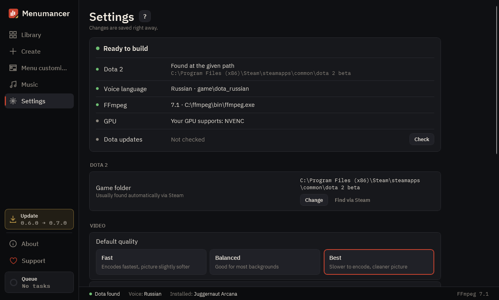

# Settings

Everything the build needs: where Dota is, FFmpeg, video quality and what the app does.

## 1. Is everything ready

Whether Dota is found, which voice language it uses and whether FFmpeg is there. If FFmpeg is missing, “Install” sets it up through winget.

## 2. Dota 2

The app finds the game folder on its own. If it doesn't, pick the dota 2 beta folder by hand.

## 3. Video

Resolution, frame rate, quality, crossfade length at the loop seam and the default menu look. New backgrounds use these settings.

## 4. Library and app

The app language and the folder where your backgrounds live.

## 5. Restore original

“Remove all mod files” gives the game back its default background and music. The app never touches Valve's files.

---

[All guides](README.md) · [Download Menumancer](https://github.com/Laraden/menumancer/releases/latest)
