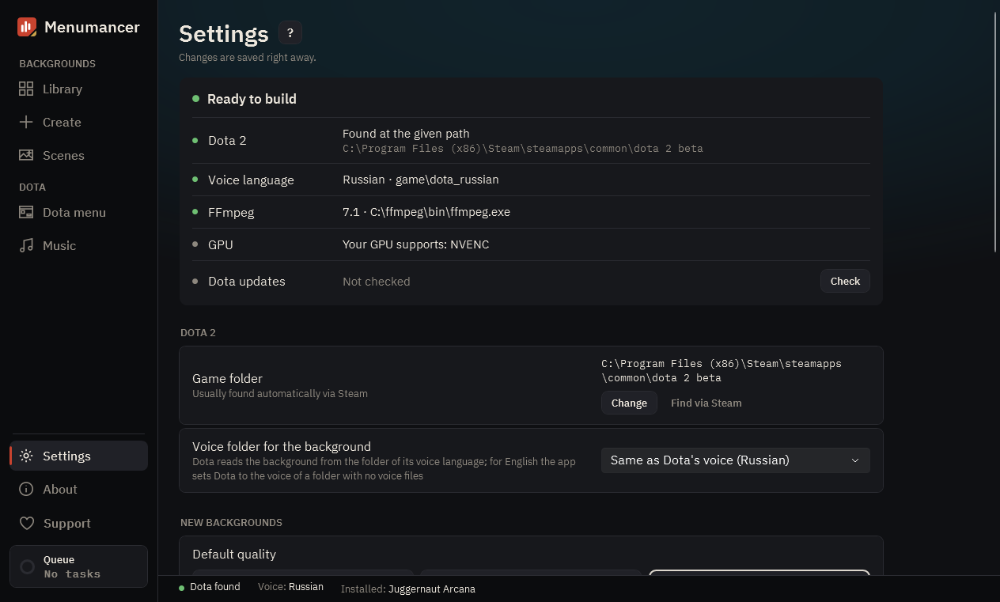

# Settings

Everything the build needs: where Dota is, FFmpeg, what every new background starts with, updates and clean Dota.

## 1. Is everything ready

Whether Dota is found, which voice language it uses and whether FFmpeg is there. If FFmpeg is missing, “Install” sets it up through winget.

## 2. Dota 2

The app finds the game folder on its own. If it doesn't, pick the dota 2 beta folder by hand.

## 3. New backgrounds

Every new background starts with these: quality, resolution, frame rate, crossfade length at the loop seam and what the menu shows. You can change all of it for one background in Create.

## 4. Updates

The app checks for updates on its own at every start and every hour while it is open, and installs them only when you click. Pre-release versions and the skipped version are under “Advanced”.

## 5. Library and app

The app language, the folder where your backgrounds live and the glow in the background's colours at the top of every page.

## 6. Clean Dota

“Back to clean Dota” takes every Menumancer file out of the game: the menu and music are Valve's own again. It runs in the queue like a build, and the line above the button says what is in Dota now. The app never touches Valve's files.

---

[All guides](README.md) · [Download Menumancer](https://github.com/Laraden/menumancer/releases/latest)
