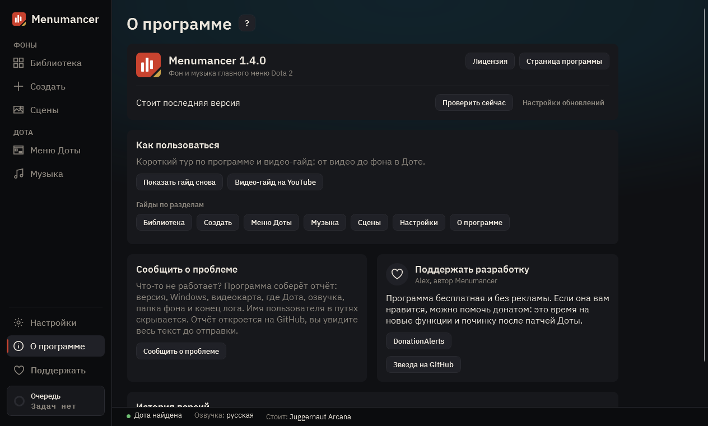

# О программе

Версия, обновления, гайды, сообщить о проблеме, поддержка разработки и история изменений.

## 1. Обновления

Версия программы и вышло ли новое. «Проверить сейчас» спрашивает GitHub, а ставится обновление только по вашей кнопке. Проверять ли самим и пробные версии: «Настройки обновлений» ведут в Настройки.

## 2. Как пользоваться

Тур по программе, видео-гайд и гайды по каждому разделу. Такой же гайд открывается кнопкой «?» у заголовка любого раздела.

## 3. Поддержать разработку

Программа бесплатная и без рекламы. Здесь можно поддержать автора.

## 4. История версий

Что менялось в каждой версии. У крупных обновлений есть «Смотреть презентацию».

---

[Все гайды](README.md) · [Скачать Menumancer](https://github.com/Laraden/menumancer/releases/latest)
