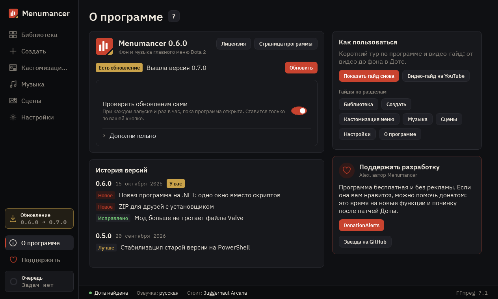

# О программе

Версия, обновления, история изменений, все гайды и как поддержать разработку.

## 1. Обновления

Программа сама проверяет обновления при каждом запуске и раз в час, пока открыта, а ставит только по вашей кнопке. «Пробные версии» предлагают то, что ещё тестируется.

## 2. История версий

Что менялось в каждой версии. У крупных обновлений есть «Смотреть презентацию».

## 3. Как пользоваться

Тур по программе, видео-гайд и гайды по каждому разделу. Такой же гайд открывается кнопкой «?» у заголовка любого раздела.

## 4. Поддержать разработку

Программа бесплатная и без рекламы. Здесь можно поддержать автора.

---

[Все гайды](README.md) · [Скачать Menumancer](https://github.com/Laraden/menumancer/releases/latest)
