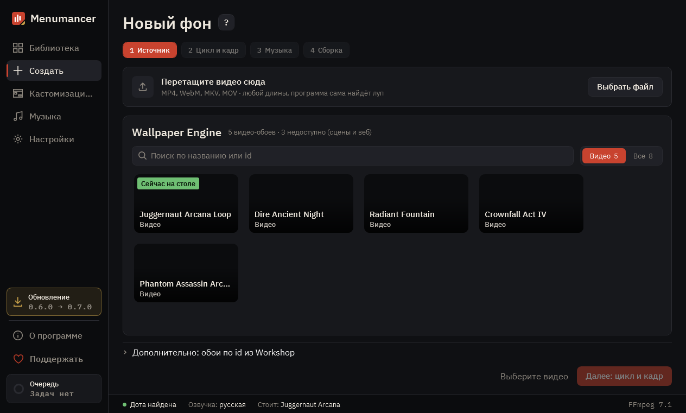

# Создать

Новый фон за четыре шага: откуда взять видео, какой отрывок крутить, какая музыка и как собрать.

## 1. Четыре шага

«Источник», «Цикл и кадр», «Музыка», «Сборка». К пройденному шагу можно вернуться, нажав на него.

## 2. Текущий шаг

Источник: видео с диска или обои Wallpaper Engine. Цикл и кадр: отрывок, который будет крутиться по кругу, и что попадёт в кадр. Музыка: без музыки, звук из видео, один трек, случайный или микс.

## 3. Дальше и сборка

На последнем шаге «Собрать» ставит фон в очередь. Сборка идёт в фоне, а с галочкой «Сразу поставить в Доту» фон сам встанет в игру.

---

[Все гайды](README.md) · [Скачать Menumancer](https://github.com/Laraden/menumancer/releases/latest)
