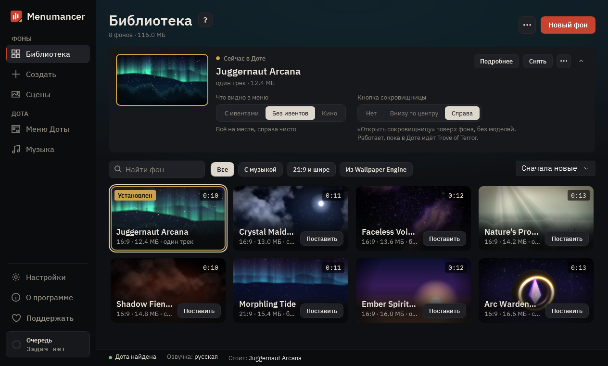

# Библиотека

Все ваши фоны для меню Доты. Здесь их ставят в игру, меняют музыку и то, что видно в меню, делятся фонами.

## 1. Новый фон

Кнопка «Новый фон» открывает раздел «Создать»: видео или обои Wallpaper Engine превращаются в фон за четыре шага.

## 2. Сейчас в Доте

Карточка над поиском показывает, что стоит в игре: постер, имя, музыку и размер. Здесь же переключатели «Что видно в меню» и «Кнопка сокровищницы»: изменения копятся в полосе внизу и ставятся в Доту одной кнопкой «Применить», пока игра закрыта. «Снять» убирает из Доты все файлы Menumancer, и меню снова как у Valve, фоны в библиотеке остаются. В «⋯»: поставить заново, музыка, папка фона и запуск Доты через Steam. Карточку можно свернуть в строку, программа это запомнит.

## 3. Поиск и фильтры

Найдите фон по имени или оставьте только нужные: «С музыкой», «21:9 и шире», «Из Wallpaper Engine».

## 4. Карточка фона

«Поставить» на карточке ставит фон в Доту, щелчок по самой карточке открывает настройки фона. Золотая рамка у того, что сейчас стоит в игре.

## 5. Поставить или снять

Главная кнопка «Поставить» кладёт фон в Доту, а у фона, который уже стоит, это «Поставить заново». «Снять» убирает его, и меню снова как у Valve. В «⋯»: «Поделиться фоном», «ZIP с видео», «Переименовать» и «Удалить фон…» с подтверждением. Если игра открыта, перезапустите её. После патча или переустановки Доты фон нужно поставить заново: просто откройте программу, она сделает это сама. Если фона в Доте нет, нажмите «Поставить» ещё раз, а если он не работает после большого патча, дождитесь обновления программы.

## 6. Что видно в меню

«С ивентами» оставляет меню как в Доте, «Без ивентов» убирает справа рекламу ивентов, «Кино» оставляет только фон, верхнюю панель и нижние. Здесь же «Кнопка сокровищницы»: по центру или справа, пока в Доте идёт Trove of Terror.

## 7. Музыка фона

Музыка в меню и в другие моменты: свой трек, плейлист или стандартная музыка Доты. Изменения применяются кнопкой «Применить», видео не перекодируется.

## 8. Ещё

«Импорт ZIP» добавляет фон, которым с вами поделились, а «Пакетная сборка…» собирает фоны из всех видео в папке.

---

[Все гайды](README.md) · [Скачать Menumancer](https://github.com/Laraden/menumancer/releases/latest)
