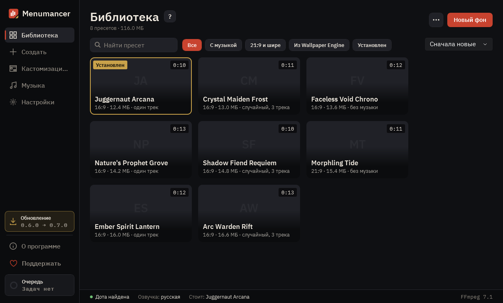

# Библиотека

Все ваши фоны для меню Доты. Здесь их ставят в игру, меняют музыку и вид меню, делятся пресетами.

## 1. Новый фон

Кнопка «Новый фон» открывает раздел «Создать»: видео или обои Wallpaper Engine превращаются в фон за четыре шага.

## 2. Поиск и фильтры

Найдите фон по имени или оставьте только нужные: «С музыкой», «21:9 и шире», «Из Wallpaper Engine», «Установлен».

## 3. Карточка фона

Наведите на карточку: «Поставить» ставит фон в Доту, «Подробнее» открывает настройки фона. Золотая рамка у того, что сейчас стоит в игре.

## 4. Поставить или снять

«Поставить» кладёт фон в Доту, «Снять» возвращает стандартный. Если игра открыта, перезапустите её.

## 5. Что видно в меню

«Стандартный» оставляет меню как в Доте, «Без ивентов» убирает справа рекламу ивентов. Здесь же «Кнопка сокровищницы»: по центру или справа, пока в Доте идёт Trove of Terror.

## 6. Музыка фона

Музыка в меню и в другие моменты: свой трек, плейлист или стандартная музыка Доты. Изменения применяются кнопкой «Применить», видео не перекодируется.

## 7. Ещё

«Импорт ZIP» добавляет фон, которым с вами поделились, а «Пакетная сборка…» собирает фоны из всех видео в папке.

---

[Все гайды](README.md) · [Скачать Menumancer](https://github.com/Laraden/menumancer/releases/latest)
