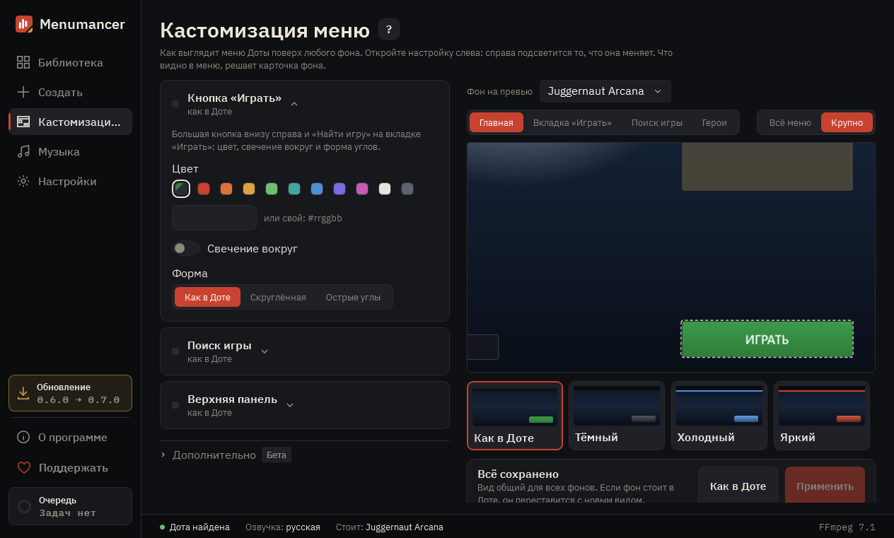

# Кастомизация меню

Свой вид главного меню Доты. На виду основное: цвет кнопки «Играть», панель поиска игры и верхняя панель. Остальное (надписи, профиль, фигурки героев, страницы) лежит в «Дополнительно» с меткой «бета»: оно уже работает, но ещё дорабатывается. Меняется только оформление через файл мода: в матче ничего не меняется, окно принятия игры, Dota Plus и осколки не трогаем.

## 1. Настройки

Каждый блок меняет одну часть меню. Откройте блок, и превью справа покажет и приблизит, что именно он меняет. Золотая метка у заголовка значит, что здесь уже не как в Доте.

## 2. Превью

Схема меню с вашими настройками. Переключайте вид: главная, вкладка «Играть», поиск матча или «Герои». Нажмите на часть схемы, чтобы открыть её настройки.

## 3. Дополнительно (бета)

Надписи на кнопках, профиль и друзья, ивенты, фигурки героев, страницы «Герои» и «Арсенал» и заставка. Они уже работают, но мы их ещё дорабатываем, поэтому вид и набор настроек могут поменяться. Если здесь что-то уже не как в Доте, у заголовка горит золотая метка.

## 4. Готовые наборы

Нажмите на набор, чтобы взять все его цвета разом. Ваши надписи на кнопках при этом остаются.

## 5. Применить

«Применить» сохраняет настройки и пересобирает установленный фон. Дота при этом должна быть закрыта. «Как в Доте» возвращает всё как было.

---

[Все гайды](README.md) · [Скачать Menumancer](https://github.com/Laraden/menumancer/releases/latest)
