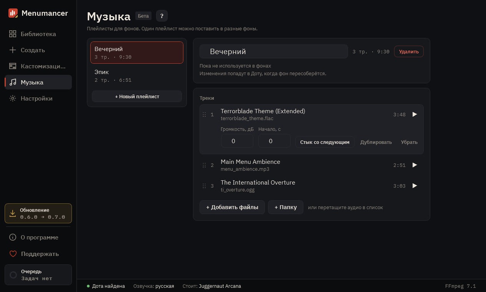

# Музыка

Плейлисты для фонов. Один плейлист можно поставить в разные фоны, а правки попадут во все.

## 1. Первый плейлист

Плейлистов пока нет: создайте первый и добавьте в него свои треки.

## 2. Плейлисты

Список ваших плейлистов. «+ Новый плейлист» создаёт ещё один.

## 3. Плейлист

Название плейлиста и в каких фонах он используется. Изменения попадут в Доту, когда фон пересоберётся.

## 4. Треки

«+ Добавить файлы» или «+ Папку», либо перетащите аудио в список. У каждого трека можно поменять порядок, громкость, начало и стык со следующим.

---

[Все гайды](README.md) · [Скачать Menumancer](https://github.com/Laraden/menumancer/releases/latest)
