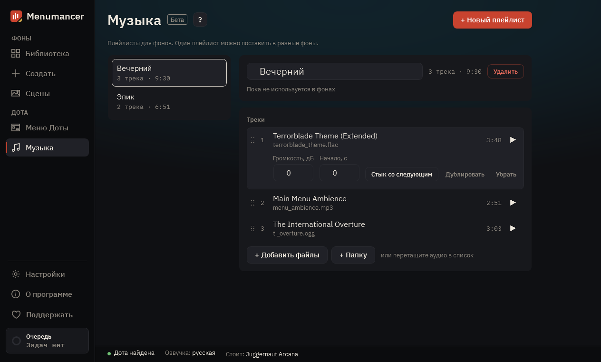

# Музыка

Плейлисты для фонов. Один плейлист можно поставить в разные фоны, а правки попадут во все.

## 1. Первый плейлист

Плейлистов пока нет: создайте первый и добавьте в него свои треки.

## 2. Плейлисты

Список ваших плейлистов. «+ Новый плейлист» вверху страницы создаёт ещё один.

## 3. Плейлист

Название плейлиста, сколько в нём треков и в каких фонах он используется. Правка сохраняется в плейлист сразу.

## 4. Старая версия в фонах

Фоны, собранные до правки плейлиста, играют в Доте старые треки. «Пересобрать фоны» обновит в них музыку через очередь задач, видео не перекодируется.

## 5. Треки

«+ Добавить файлы» или «+ Папку», либо перетащите аудио в список. У каждого трека можно поменять порядок, громкость, начало и стык со следующим.

---

[Все гайды](README.md) · [Скачать Menumancer](https://github.com/Laraden/menumancer/releases/latest)
