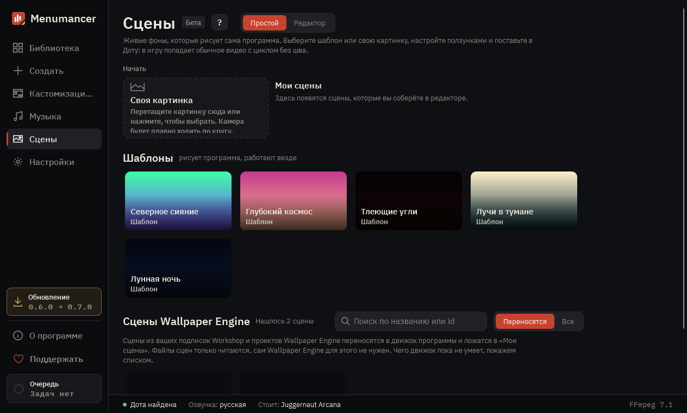

# Сцены

Живые фоны, которые рисует сама программа: северное сияние, космос, угли или ваша картинка с объёмом. В Доту попадает обычное видео с циклом без шва.

## 1. Шаблоны

Готовые сцены программы. В них нет ни одной чужой картинки: всё нарисовано шейдерами, поэтому фон можно смело показывать и передавать. Плитка открывает сцену, «← Все сцены» над превью возвращает сюда.

## 2. Своя картинка

Перетащите картинку на экран или нажмите на рамку, и она станет живым фоном: камера плавно ходит по кругу. С «Объёмом» над превью нейросеть считает, что ближе, а что дальше, и ближнее движется сильнее дальнего. Нейросеть скачивается один раз.

## 3. Мои сцены

Сцены, которые вы собрали в редакторе или перенесли из Wallpaper Engine. В «Дополнительно» внизу: «Пустая сцена» начинает с чистого неба, «Открыть папку…» открывает любую папку со scene.json.

## 4. Сцены Wallpaper Engine

Сцены из ваших подписок Workshop. Значок говорит, переносится ли сцена в движок программы целиком, частично или пока нет; фильтр «Переносятся» прячет последние. Плитка переносит сцену в «Мои сцены», файлы WE только читаются.

## 5. Превью

Сцена идёт вживую, как будет в меню Доты. Цикл замкнут: конец переходит в начало без шва. «Пауза» останавливает кадр.

## 6. Настройки сцены

Цвета, яркость, количество снега или углей: у каждого шаблона свои. Превью меняется сразу, «Сбросить» возвращает как было.

## 7. Установить в Доту

«Установить в Доту» в строке над превью рендерит сцену в видео под ваш монитор, собирает фон и ставит его в Доту; ход виден прямо на кнопке, со страницы можно уйти. ▾ рядом открывает название фона и кадры: 30 оптимально, рекомендуем, 60 для хороших ПК. Под «Дополнительно» качество и «Только в библиотеку».

## 8. Редактор

«Редактор» показывает, из чего сделана сцена: слои слева, превью в центре, настройки выбранного слоя справа. Ползунки простого режима при этом не пропадают, их значения переходят в сцену.

## 9. Слои

Верхний слой ближе к зрителю. «+ Слой» добавляет шейдер, частицы, свою картинку, 3D-модель (.glb), градиент или группу; стрелки меняют порядок, глаз прячет слой. Любую правку отменяет «↶».

## 10. Настройки слоя

Основное видно сразу, редкое лежит в «Дополнительно». «∿» качает значение волной, период подбирается так, чтобы цикл остался без шва. «◉» выносит поле в ползунки простого режима. «Сохранить сцену» кладёт её в «Мои сцены».

---

[Все гайды](README.md) · [Скачать Menumancer](https://github.com/Laraden/menumancer/releases/latest)
