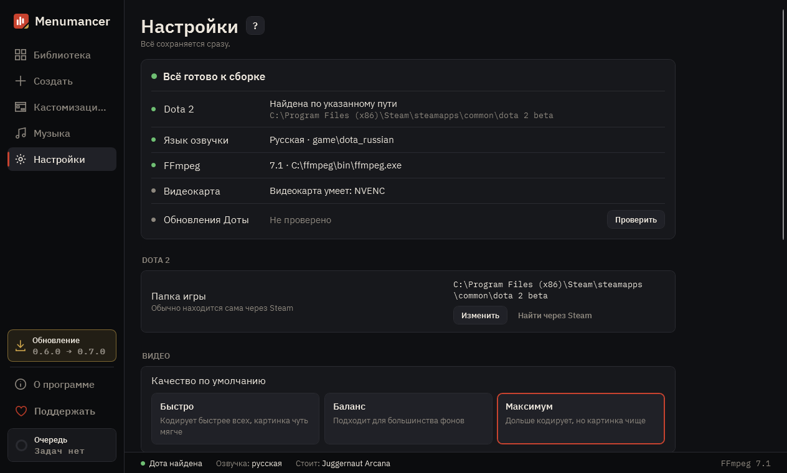

# Настройки

Всё, что нужно для сборки: где Дота, FFmpeg, качество видео и что делает программа.

## 1. Всё ли готово

Найдена ли Дота, какая озвучка и есть ли FFmpeg. Если FFmpeg нет, кнопка «Установить» поставит его через winget.

## 2. Dota 2

Папка игры находится сама. Если нет, укажите папку dota 2 beta вручную.

## 3. Видео

Разрешение, частота кадров, качество, длина кроссфейда на стыке цикла и вид меню по умолчанию. Эти настройки берутся для новых фонов.

## 4. Библиотека и программа

Язык программы и папка, где лежат ваши фоны.

## 5. Восстановить оригинал

«Убрать мод из Доты» возвращает игре стандартный фон и музыку. Файлы Valve программа не трогает.

---

[Все гайды](README.md) · [Скачать Menumancer](https://github.com/Laraden/menumancer/releases/latest)
