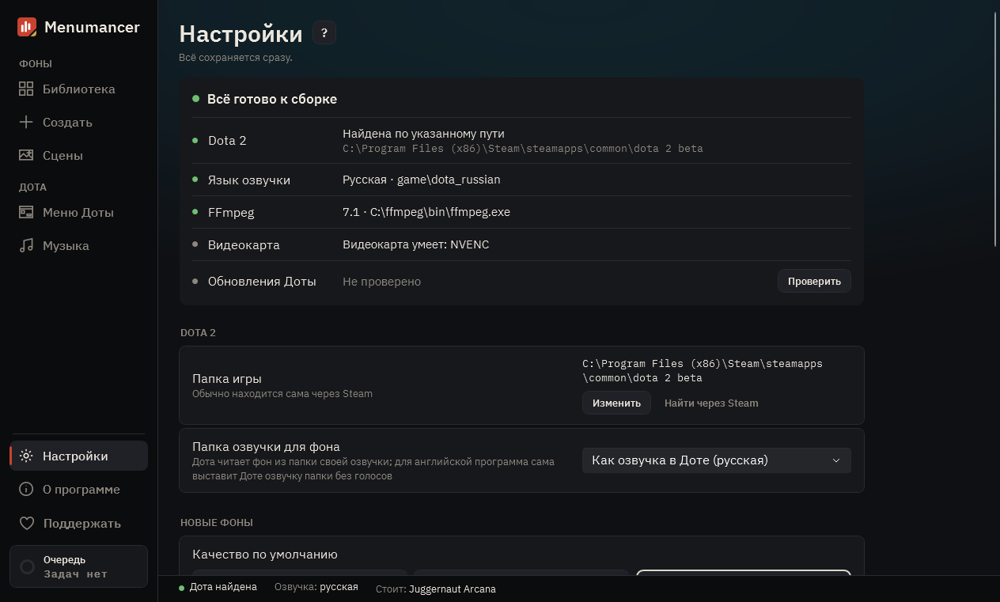

# Настройки

Всё, что нужно для сборки: где Дота, FFmpeg, с чего начинается новый фон, обновления и чистая Дота.

## 1. Всё ли готово

Найдена ли Дота, какая озвучка и есть ли FFmpeg. Если FFmpeg нет, кнопка «Установить» поставит его через winget.

## 2. Dota 2

Папка игры находится сама. Если нет, укажите папку dota 2 beta вручную.

## 3. Новые фоны

С этого начинается каждый новый фон: качество, разрешение, частота кадров, длина кроссфейда на стыке цикла и что видно в меню. Для одного фона всё это меняется в «Создать».

## 4. Обновления

Программа сама проверяет обновления при каждом запуске и раз в час, пока открыта, а ставит только по вашей кнопке. В «Дополнительно» пробные версии и пропущенная версия.

## 5. Библиотека и программа

Язык программы, папка, где лежат ваши фоны, и подсветка верха страниц цветами фона.

## 6. Чистая Дота

«Вернуть чистую Доту» убирает из игры все файлы Menumancer: меню и музыка снова как у Valve. Работа идёт в очереди, как сборка, а над кнопкой видно, что сейчас в Доте. Файлы Valve программа не трогает.

---

[Все гайды](README.md) · [Скачать Menumancer](https://github.com/Laraden/menumancer/releases/latest)
