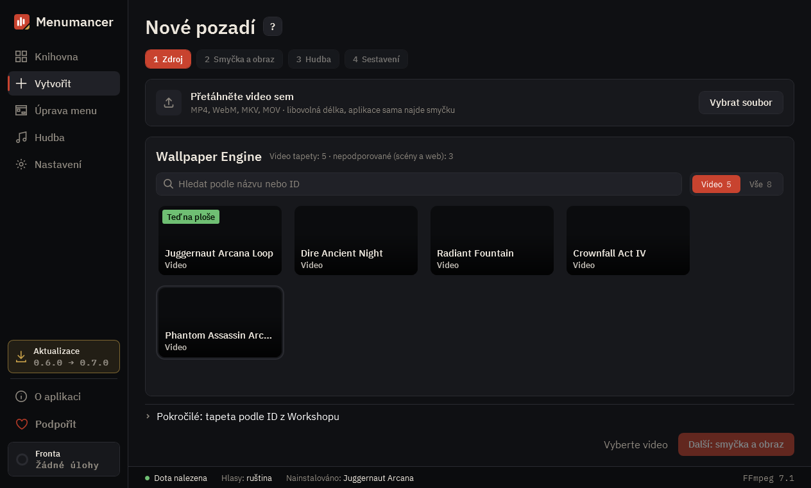

# První pozadí

**Vytvořit** udělá z videa pozadí menu Doty ve čtyřech krocích: **Zdroj**, **Smyčka a obraz**, **Hudba**, **Sestavení**. Na krok, který už máte za sebou, můžete kliknout a vrátit se k němu.

## Jaké video vybrat

Dota přehrává pozadí jako krátké video, které se pořád opakuje. Nejlépe fungují videa, která:

- se pohybují pomalu a rovnoměrně: mlha, déšť, oheň, voda, mraky, klidná postava;
- nemají střih v úseku, který chcete opakovat;
- jsou klidná uprostřed a vlevo, protože okraje zakryje tlačítko Hrát, chat a panely událostí.

Délka je libovolná: dobrou smyčku aplikace najde sama. Používejte vlastní videa, videa pod svobodnou licencí nebo ta, která používat smíte; proč na tom záleží, viz [Sdílení](sharing.md).

## 1. Zdroj

Přetáhněte video do okna nebo klikněte na **Vybrat soubor**. Fungují MP4, WebM, MKV i MOV. Když aplikace napíše **Video načteno, můžete pokračovat**, klikněte na **Další: smyčka a obraz**.

Pokud máte Wallpaper Engine, níže uvidíte svoje video tapety. Ta, která je právě na ploše, má štítek. Scény jsou pod filtrem **Scény** (beta), viz [Wallpaper Engine](wallpaper-engine.md).

## 2. Smyčka a obraz

Tady pozadí opravdu vzniká.

**Vyberte úsek.** V části **Navrženo** aplikace ukáže úseky videa, které se nejlépe opakují: krátké, vyvážené a dlouhé. Procento říká, jak nenápadný je spoj: od 90 % ho obvykle není vidět. Upozornění řeknou, co čekat:

- **střih uvnitř**: v úseku je střih;
- **škubnutí na spoji**: obraz sedí, ale pohyb ne, prolínání to schová;
- **skoro bez pohybu**: uvnitř se skoro nic nehýbe.

**Celý klip** použije celé video. Konce úseku můžete posouvat na časové ose i sami. **Doladit spoj** posune konec až o sekundu na snímek s nejlepším spojem.

**Vyzkoušejte to.** Pusťte náhled. **Menu Doty** přes něj položí náhled menu, takže vidíte, co zakryjí tlačítka. **Spoj** zvýrazní spoj na časové ose a tlačítko vedle na něj přetočí.

**Spoj smyčky.**

- **Prolínání**: konec plynule přejde do začátku. **Délka přechodu** určuje jak dlouho; většině videí sedí 1–1,5 s.
- **Ping-pong**: dopředu, pak pozpátku. Hodí se na pomalý pohyb kamery, jen pro krátké úseky.
- **Žádné**: klip prostě začne znovu. Když je hodnocení spoje už velmi vysoké.

**Formát obrazovky:** běžný monitor (16:9), širokoúhlý (21:9) nebo superširokoúhlý (32:9).

**Styl menu:** **Standardní** nechá menu jako v Dotě. **Bez událostí** nechá všechno, ale uvolní pravou stranu od panelů událostí, takže je vidět víc pozadí.

V **Pokročilých** je rozlišení, ořez a umístění (vyplnit obrazovku, rozmazané okraje, roztáhnout nebo černé pruhy), snímky za sekundu a filtry: **Ztmavení** zlepší čitelnost menu, **Viněta** ztmaví okraje, **Ostrost** pomůže po kompresi.

## 3. Hudba

Vyberte, co hraje v menu a v dalších chvílích: při spuštění, při výběru hrdiny, při výhře a prohře.

- **bez hudby**: zůstane hudba samotné Doty;
- **zvuk z videa**;
- **jedna skladba**, **náhodná skladba** nebo **mix** z playlistu. Playlisty najdete v sekci **Hudba** a jeden playlist může používat víc pozadí.

Pokud máte v Dotě nasazený placený hudební balíček, hraje on. Aplikace nikdy nenahrazuje nic, co prodává Valve.

## 4. Sestavení

Pojmenujte pozadí. Nechte zaškrtnuté **Hned nainstalovat do Doty**, pokud ho chcete ve hře, jakmile bude hotové. Klikněte na **Sestavit**.

Dota přijme video menu nejvýš 19,2 MB. Aplikace ladí kvalitu při kódování tak, aby se soubor vešel; souhrn ukáže, kolik zbylo rezervy. Sestavení běží ve **Frontě** (vlevo dole), takže můžete aplikaci dál používat.

## 5. Ve hře

Před instalací Dotu zavřete a pak ji spusťte. Pokud byla Dota během instalace otevřená, restartujte ji. Pozadí je teď v **Knihovně**, kde můžete nainstalovat jiné, odebrat ho tlačítkem **Odebrat z Doty** nebo v **Podrobnostech** změnit hudbu a styl menu bez nového sestavení.

Nezobrazuje se? Viz [Řešení potíží](troubleshooting.md).

## Tipy

- **30 snímků za sekundu** je výchozí a doporučená hodnota. 60 vypadá plynuleji, ale dokud je menu otevřené, zatěžuje PC dvakrát víc; nastavíte to v **Nastavení → Video**, pokud máte výkonné PC.
- **Hromadné sestavení…** v nabídce Knihovny udělá pozadí z každého videa ve složce, s výchozím nastavením a bez hudby.
- Nemáte vhodné video? Ve **Scénách** jsou živá pozadí, která kreslí sama aplikace. Viz [Živé scény](live-scenes.md).

---

[Všechny návody](README.md) · [Stáhnout Menumancer](https://github.com/Laraden/menumancer/releases/latest)
