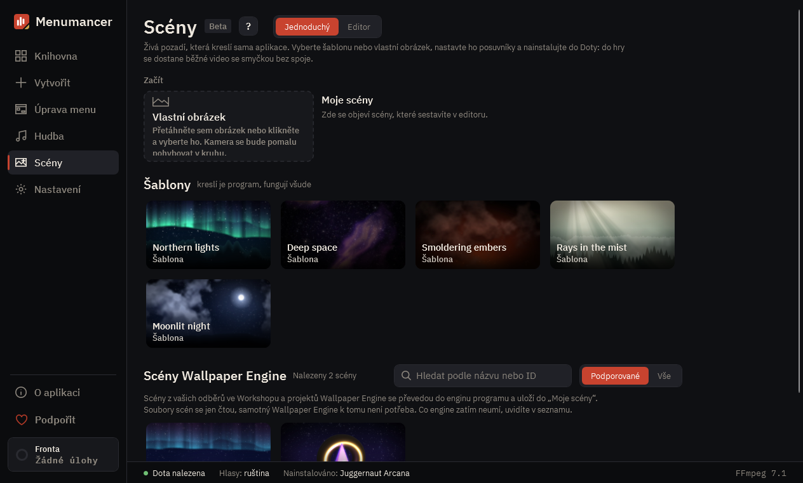

# Živé scény

**Scény** (beta) dělají pozadí bez jakéhokoli videa: kreslí je vlastní engine aplikace. Do Doty přesto jde obyčejné video s plynulou smyčkou, takže scéna hru nezatíží víc než jakékoli jiné pozadí.

## Šablony

Pět scén, které aplikace kreslí celé sama: **Northern lights** (polární záře), **Deep space** (hluboký vesmír), **Smoldering embers** (žhavé uhlíky), **Rays in the mist** (paprsky v mlze) a **Moonlit night** (měsíční noc). Není v nich jediný cizí obrázek, takže je můžete volně ukazovat i sdílet.

1. Otevřete **Scény** a klikněte na šablonu.
2. Nalaďte ji posuvníky vpravo: barvy, jas, množství sněhu nebo uhlíků. **Obnovit** vrátí výchozí hodnoty.
3. Klikněte na **Nainstalovat do Doty** nad náhledem.

Aplikace vykreslí scénu do videa pro váš monitor, sestaví pozadí a nainstaluje ho. Průběh je vidět přímo na tlačítku a stránku můžete mezitím opustit. **▾** vedle tlačítka nastaví název pozadí a snímky za sekundu (30 je doporučeno, 60 pro výkonná PC). **Jen do knihovny** pozadí sestaví bez instalace.

## Vlastní obrázek

Přetáhněte obrázek na blok **Vlastní obrázek** nebo na něj klikněte. Obrázek se stane živým pozadím: kamera se pomalu pohybuje v kruhu. Zapněte **Hloubka** nad náhledem a malá neuronová síť odhadne, co je blízko a co daleko, takže blízké věci se hýbou víc než vzdálené. Síť se stáhne jednou, při prvním použití.

Nejlépe funguje široký detailní obrázek s jasným popředím: krajina, ulice města, postava před pozadím.

## Editor

Přepněte z **Jednoduchý** na **Editor** a uvidíte, z čeho je scéna složená: vrstvy vlevo, náhled uprostřed, nastavení vybrané vrstvy vpravo.

- **+ Vrstva** přidá shader, částice, vlastní obrázek, 3D model (`.glb`), přechod nebo skupinu. Horní vrstva je divákovi nejblíž.
- Šipky mění pořadí, oko vrstvu skryje, **↶** vrátí jakoukoli změnu.
- **∿** rozhoupe hodnotu ve vlně. Periodu aplikace vybere tak, aby smyčka zůstala plynulá.
- **◉** přidá nastavení mezi posuvníky jednoduchého režimu.
- **Uložit scénu** ji uloží do **Moje scény**.

V **Pokročilých** dole na úvodní stránce: **Prázdná scéna** začne s čistou oblohou a **Otevřít složku…** otevře libovolnou složku se `scene.json`. Pro ty, kdo chtějí psát scény ručně, je popsaný formát (anglicky): [formát scén](../../scene-format.md).

## Scény Wallpaper Engine

Pokud máte Wallpaper Engine, scény z vašich odběrů jsou dole v sekci **Scény**. Aplikace je převede do vlastního enginu, viz [Wallpaper Engine](wallpaper-engine.md).

## Dobré vědět

- Vykreslení trvá pár minut podle scény a grafické karty. Běží ve **Frontě**.
- Co vidíte v náhledu, to půjde do Doty. Délka smyčky je součástí scény a aplikace hlídá, aby konec plynule navázal na začátek.
- Scény jsou beta: většina věcí funguje, něco se ještě může změnit. Pokud scéna nevypadá správně, [dejte nám vědět](https://github.com/Laraden/menumancer/issues/new/choose).

---

[Všechny návody](README.md) · [Stáhnout Menumancer](https://github.com/Laraden/menumancer/releases/latest)
