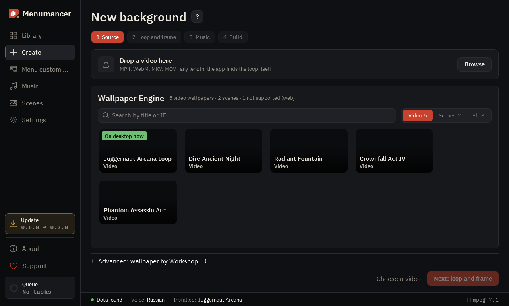

# Your first background

**Create** turns a video into a Dota menu background in four steps: **Source**, **Loop and frame**, **Music**, **Build**. You can click a step you've already done to go back to it.

## Pick a good video

Dota plays the background as a short video that repeats over and over. The best ones:

- move slowly and evenly: fog, rain, fire, water, clouds, a calm character;
- have no cuts inside the part you want to loop;
- keep the middle and the left side calm, because the Play button, the chat and the event panels cover the edges.

Any length works: the app finds a good loop by itself. Use videos you made, ones under a free license, or ones you're allowed to use; see [Sharing](sharing.md) for why this matters.

## 1. Source

Drop a video onto the window or click **Browse**. MP4, WebM, MKV and MOV all work. When the app says **Video checked, ready for the next step**, click **Next: loop and frame**.

If Wallpaper Engine is installed, your video wallpapers are listed below. A badge marks the one on your desktop right now. Scenes are under the **Scenes** filter (beta), see [Wallpaper Engine](wallpaper-engine.md).

## 2. Loop and frame

This is where the background is really made.

**Pick a segment.** Under **Suggested** the app lists the parts of the video that loop best, short, balanced and long. The percentage says how invisible the seam is: 90% and above is usually invisible. Warnings tell you what to expect:

- **cut inside**: there's an edit cut in the segment;
- **jerk at the seam**: the picture matches but the motion doesn't, a crossfade hides it;
- **almost still**: almost nothing moves.

**Whole clip** uses the entire video. You can also drag the ends of the segment on the timeline yourself. **Fine-tune seam** moves the end by up to a second to the frame with the best seam.

**Check it.** Play the preview. **Dota menu** puts a mock of the menu on top so you see what the buttons cover. **Seam** highlights the seam on the timeline, and the jump button goes straight to it.

**Loop blend.**

- **Crossfade** blends the end smoothly into the start. **Transition length** sets how long; 1–1.5 s suits most videos.
- **Ping-pong** plays forward, then backward. Good for slow camera moves, for short segments only.
- **None** just starts over. Use it when the seam score is already very high.

**Screen format:** Standard monitor (16:9), Ultrawide (21:9) or Super ultrawide (32:9).

**Menu style:** **Standard** keeps the menu as in Dota. **No events** keeps everything but clears the event panels on the right, so more of your background shows.

Under **Advanced** are resolution, framing (fill the screen, blurred sides, stretch or black bars), frames per second and filters: **Dimming** makes the menu easier to read, **Vignette** darkens the edges, **Sharpness** helps after compression.

## 3. Music

Choose what plays in the menu and at other moments, such as startup, hero pick, victory and defeat:

- **no music**: Dota's own music stays;
- **sound from the video**;
- **one track**, a **random track** or a **mix** from a playlist. Playlists live in **Music** and can be shared by several backgrounds.

If you have a paid music pack equipped in Dota, the pack plays. The app never replaces anything Valve sells.

## 4. Build

Give the background a name. Leave **Install into Dota right away** on if you want it in the game as soon as it's ready. Click **Build**.

Dota accepts a menu video of at most 19.2 MB. The app tunes the quality while encoding so the file fits; the summary shows how much room was left. The build runs in the **Queue** (bottom left), so you can keep using the app.

## 5. In the game

Close Dota before installing, then start it. If Dota was open during the install, restart it. The background is now in your **Library**, where you can install another one, remove it with **Remove from Dota**, or change its music and menu style under **More details** without building again.

Not showing up? See [Troubleshooting](troubleshooting.md).

## Tips

- **30 fps** is the default and recommended. 60 fps looks smoother but doubles the load while the menu is open; set it in **Settings → Video** if your PC is strong.
- **Batch build…** in the Library menu makes a background from every video in a folder, with default settings and no music.
- No video at hand? **Scenes** has live backgrounds drawn by the app itself. See [Live scenes](live-scenes.md).

---

[All guides](README.md) · [Download Menumancer](https://github.com/Laraden/menumancer/releases/latest)
