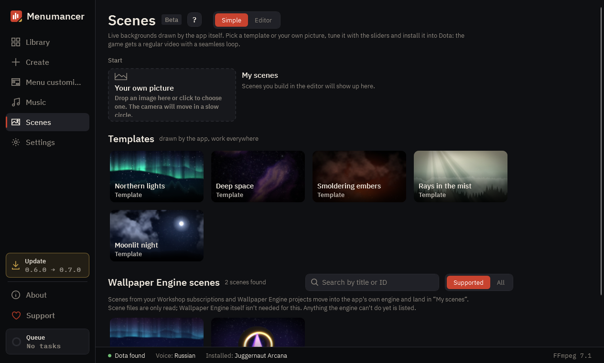

# Live scenes

**Scenes** (beta) makes backgrounds without any video: the app draws them with its own engine. Dota still gets an ordinary video that loops without a seam, so a scene costs the game no more than any other background.

## Templates

Five scenes drawn entirely by the app: **Northern lights**, **Deep space**, **Smoldering embers**, **Rays in the mist** and **Moonlit night**. There isn't a single picture by anyone else in them, so you can show and share them freely.

1. Open **Scenes** and click a template.
2. Tune it with the sliders on the right: colours, brightness, the amount of snow or embers. **Reset** brings the defaults back.
3. Click **Install into Dota** above the preview.

The app renders the scene to a video for your monitor, builds the background and installs it. Progress shows on the button, and you can leave the page while it works. The **▾** next to the button sets the background name and the frame rate (30 is recommended, 60 is for strong PCs). **Library only** builds it without installing.

## Your own picture

Drop a picture onto **Your own picture** or click it. The picture becomes a live background: the camera moves in a slow circle. Turn on **Depth** above the preview and a small neural network works out what is near and what is far, so near things move more than far ones. The network downloads once, the first time you use it.

A wide, detailed picture with a clear foreground works best: a landscape, a city street, a character in front of a background.

## The editor

Switch from **Simple** to **Editor** to see what a scene is made of: layers on the left, the preview in the middle, the settings of the selected layer on the right.

- **+ Layer** adds a shader, particles, your own picture, a 3D model (`.glb`), a gradient or a group. The top layer is closest to the viewer.
- The arrows change the order, the eye hides a layer, **↶** undoes any change.
- **∿** makes a value swing in a wave. The app picks the period so the loop stays seamless.
- **◉** puts a setting among the sliders of the simple mode.
- **Save scene** keeps it in **My scenes**.

Under **Advanced** at the bottom of the start page, **Empty scene** starts from a clear sky and **Open folder…** opens any folder with a `scene.json`. The scene format is documented for people who want to write scenes by hand: [scene format](../../scene-format.md).

## Wallpaper Engine scenes

If you have Wallpaper Engine, the scenes from your subscriptions are listed at the bottom of **Scenes**. The app moves them into its own engine; see [Wallpaper Engine](wallpaper-engine.md).

## Good to know

- Rendering takes a few minutes, depending on the scene and your graphics card. It runs in the **Queue**.
- What you see in the preview is what goes into Dota. The loop length is part of the scene, and the app makes sure the end flows into the start.
- Scenes is a beta: most things work, some may change. If a scene looks wrong, [tell us](https://github.com/Laraden/menumancer/issues/new/choose).

---

[All guides](README.md) · [Download Menumancer](https://github.com/Laraden/menumancer/releases/latest)
