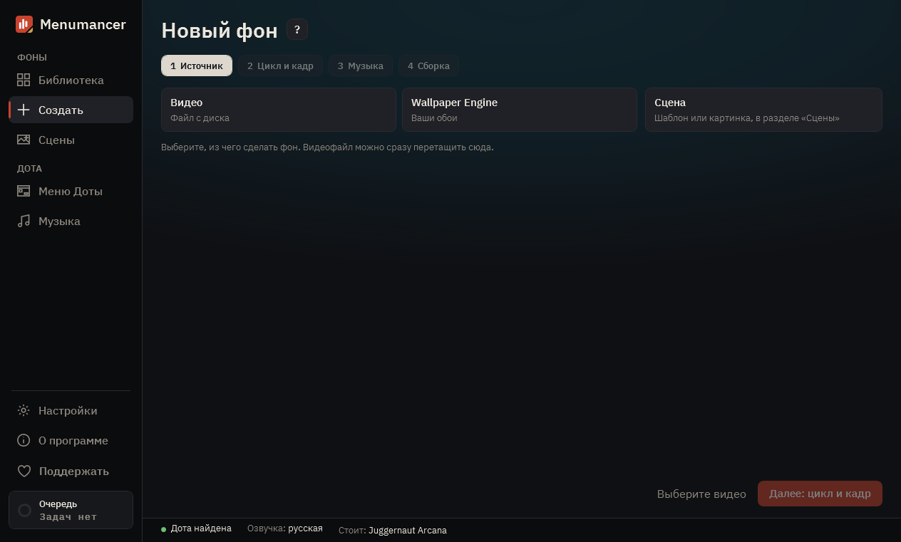

# Первый фон

**Создать** превращает видео в фон меню Доты за четыре шага: **Источник**, **Цикл и кадр**, **Музыка**, **Сборка**. На уже пройденный шаг можно нажать, чтобы вернуться.

## Какое видео подойдёт

Дота крутит фон как короткое видео, которое повторяется снова и снова. Лучше всего подходят ролики, которые:

- двигаются медленно и ровно: туман, дождь, огонь, вода, облака, спокойный персонаж;
- без монтажных склеек в том куске, который хотите зациклить;
- спокойные в центре и слева, потому что края закрывают кнопка «Играть», чат и панели ивентов.

Длина любая: хороший цикл программа найдёт сама. Берите свои видео, видео под свободной лицензией или те, которые вам разрешено использовать; почему это важно, см. [Как делиться](sharing.md).

## 1. Источник

Вверху три плитки: **Видео**, **Wallpaper Engine** и **Сцена**. Под плиткой **Видео** перетащите видео в окно или нажмите **Выбрать файл**. Подойдут MP4, WebM, MKV и MOV. Когда программа напишет **Видео прочитано, можно дальше**, нажмите **Далее: цикл и кадр**.

Плитка **Wallpaper Engine** открывает ваши видео-обои, если Wallpaper Engine стоит. Те, что сейчас на рабочем столе, отмечены значком. Сцены под фильтром **Сцены** (бета), см. [Wallpaper Engine](wallpaper-engine.md).

**Сцена** ведёт в раздел **Сцены**: там живые фоны из шаблона или картинки.

**Собрать сразу.** Когда видео прочитано, рядом с **Далее** есть кнопка **Собрать сразу**. Программа найдёт лучший отрезок, возьмёт значения из **Настроек**, музыку Доты и имя по видео и сразу начнёт сборку. Поиск можно отменить. Если ровного цикла в видео нет, программа скажет об этом и откроет **Цикл и кадр**, чтобы выбрать отрезок самому.

## 2. Цикл и кадр

Здесь фон и делается.

**Выберите отрезок.** В блоке **Предложено** программа показывает куски видео, которые лучше всего зацикливаются: короткие, средние и длинные. Процент говорит, насколько незаметен стык: от 90% его обычно не видно. Предупреждения подскажут, чего ждать:

- **склейка внутри**: в отрезке есть монтажная склейка;
- **рывок на стыке**: картинка совпала, а движение нет, кроссфейд это скроет;
- **почти не движется**: внутри почти ничего не происходит.

**Весь ролик** берёт всё видео целиком. Концы отрезка можно двигать на таймлайне и самому. **Подровнять стык** сдвигает конец в пределах секунды к кадру, где стык лучше.

**Проверьте.** Запустите превью. **Меню Доты** кладёт поверх макет меню, видно, что закроют кнопки. **Шов** подсвечивает стык на таймлайне, а кнопка рядом перематывает прямо к нему.

**Стык.**

- **Кроссфейд**: конец плавно переходит в начало. **Длина перехода** задаёт, насколько долго; большинству видео подходит 1–1,5 с.
- **Пинг-понг**: вперёд, затем назад. Хорош для медленного движения камеры, только для коротких отрезков.
- **Нет**: ролик просто начинается заново. Если оценка стыка и так очень высокая.

**Формат экрана:** обычный монитор (16:9), широкий (21:9) или сверхширокий (32:9).

**Что видно в меню:** **С ивентами** оставляет меню как в Доте. **Без ивентов** оставляет всё, но убирает панели ивентов справа, и фона видно больше. **Кино** оставляет только фон, верхнюю панель и нижние; друзья и ивенты открываются кнопками. Значения на этом шаге берутся из **Настройки → Новые фоны** и меняются здесь только для этого фона.

В **Дополнительно** — разрешение, кадрирование (заполнить экран, размытые края, растянуть или чёрные поля) и кадры в секунду.

**Вид** — вторая вкладка правой колонки. Выберите готовый образ (Спокойный, Кино, Нуар, Тёплый, Холодный, Плёнка, Сон): каждый показан на кадре вашего видео, силу образа можно убавить. Или двигайте ползунки сами: **Затемнение** делает меню читаемее, **Виньетка** затемняет края, **Резкость** помогает после сжатия, а ещё есть яркость, контраст, цвет, размытие, зерно и чёрные полосы кино. Держите **Сравнить**, чтобы увидеть ролик без вида. Превью показывает, каким фон получится в готовом файле.

## 3. Музыка

Выберите, что звучит в меню и в другие моменты: на заставке, на выборе героя, на победе и поражении.

- **без музыки**: остаётся музыка самой Доты;
- **звук из видео**;
- **один трек**, **случайный трек** или **микс** из плейлиста. Плейлисты живут в разделе **Музыка**, один плейлист могут использовать несколько фонов. Если плейлист поправили после сборки, кнопка **Пересобрать фоны** там же обновит музыку во всех фонах с ним, видео при этом не перекодируется.

Если в Доте надет платный музыкальный пак, звучит он. Программа никогда не подменяет то, что продаёт Valve.

## 4. Сборка

Дайте фону имя. Новое видео получает новое имя по файлу; если такое имя уже есть в библиотеке, программа предложит «Имя 2», а под занятым именем, набранным вручную, появится тихая подсказка. Оставьте галочку **Сразу поставить в Доту**, если хотите, чтобы фон встал в игру, как только будет готов. Нажмите **Собрать**.

Дота принимает видео меню не больше 19,2 МБ. Программа подбирает качество при кодировании так, чтобы файл влез; в итоге видно, какой остался запас. Сборка идёт в **Очереди** (слева внизу), программой можно пользоваться дальше. Если сборка упала или вы её отменили, **Собрать ещё раз** запустит её снова с теми же настройками.

## 5. В игре

Перед установкой закройте Доту, потом запустите её. Если Дота была открыта во время установки, перезапустите её. Фон теперь лежит в **Библиотеке**: там можно поставить другой, снять этот кнопкой **Снять** или щелчком по карточке открыть его настройки и поменять музыку и то, что видно в меню, не собирая заново.

Не появился? См. [Если что-то не работает](troubleshooting.md).

## Советы

- **30 кадров** по умолчанию, это оптимально. 60 плавнее, но вдвое нагружают ПК, пока открыто меню; включайте в **Настройки → Новые фоны**, если ПК мощный.
- **Пакетная сборка…** в меню Библиотеки делает фон из каждого видео в папке, с настройками по умолчанию и без музыки.
- Нет подходящего видео? В **Сценах** есть живые фоны, которые рисует сама программа. См. [Живые сцены](live-scenes.md).

---

[Все гайды](README.md) · [Скачать Menumancer](https://github.com/Laraden/menumancer/releases/latest)
